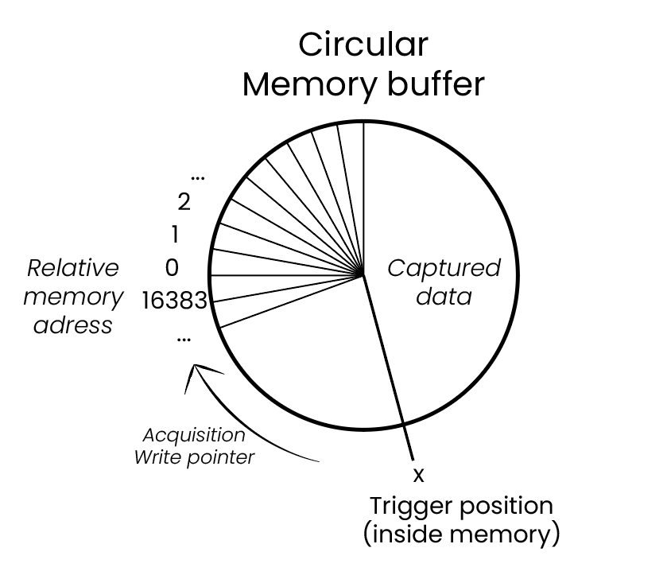
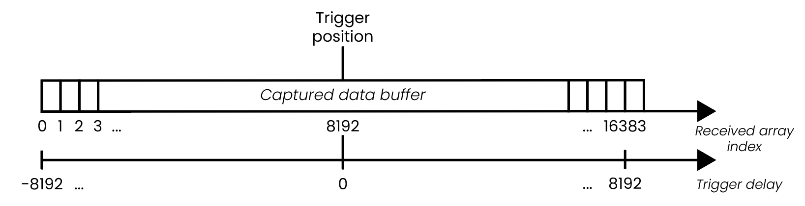

.. _intro_gen_acq:

Introduction to data acquisition and generation with Red Pitaya
*******************************************************************

Red Pitaya can generate signals on its analog outputs and acquire signals on its analog inputs using web applications, remote commands, or programs 
running on the board. This introduction explains how to choose an approach, configure and trigger a capture or output, and find the detailed command 
references and examples. Available channels, rates, memory sizes, trigger sources, and features depend on the board model, FPGA image, and OS version; 
check the relevant hardware and command references before relying on a specific limit.

.. note::

    Some boards like :ref:`SDRlab 122-16 <top_122_16>` have AC coupling on inputs and outputs, which may limit the available acquisition and generation 
    frequency range.

Choose the method that best fits the task:

* Use `Oscilloscope and other applications`_ to interactively view signals and make measurements.
* Use `SCPI commands`_ to control the board remotely from a host program, for example MATLAB, Python, or LabVIEW.
* Use `API commands (C++, Python)`_ to write programs that run on the board and need direct access to its APIs or operating system.
* Use `Deep Memory Mode (DMM)`_ when a larger buffer is needed for generating or acquiring data.
* Use the `Streaming application`_ for continuous data transfer to a computer or storage; its supported rates and trigger capabilities differ from triggered acquisition.
* Use `Custom acquisition and generation (FPGA)`_ when the existing interfaces do not meet the timing or functionality requirements.

|

Oscilloscope and other applications
======================================

The easiest way to acquire or generate signals is to use a pre-built application, such as the oscilloscope, spectrum analyser, or Bode analyser, 
available through the web interface. This approach is useful for interactive measurement and setup; application features and export options vary.

Applications acquire data into buffers, process it, and display the results. When supported by the application, data can be exported or saved on 
request. For automated remote acquisition, use SCPI, an API, or the :ref:`Data stream control application <streaming_top>`.

Some applications also control the signal generator, allowing inputs and outputs to be used together. Depending on the application and board, the 
generator may provide predefined waveforms, |wiki-arbitrary-waveform| generation, bursts, or sweeps.

Where supported, the AWG functionality lets you upload a custom waveform using the :ref:`ARB waveform manager application <arb_manager_app>` 
and select it from the *Waveform Type* menu. Waveform length, amplitude limits, and upload format depend on the application and board. See 
the `SCPI commands`_ section and the application documentation for details. Generally, the uploaded waveform will be used as-is by the AWG, 
the amplitude will be normalised to fit within the allowed output range.

For more information on the applications and how they work, click here:

* :ref:`Red Pitaya applications <all_apps>`
* Application source code is available on our :rp-github:`GitHub <RedPitaya/tree/master/apps-tools>`.

|

Running multiple web applications simultaneously
---------------------------------------------------

.. warning::

    Running multiple web applications at the same time (for example, the oscilloscope and the SCPI server) is **not recommended**. 
    Each web module runs in *exclusive mode* to prevent FPGA conflicts, so launching a second application may cause conflicts in data 
    acquisition and generation leading to undefined behaviour.

An exception is running one of the web applications which uses the v0.94 FPGA image (like **Oscilloscope**) and **JupyterLab** simultaneously, 
which is possible with some precautions:

-   The JupyterLab code must **not** interfere with the oscilloscope (e.g. do not set triggers, decimation, or channel settings that 
    conflict with the oscilloscope). Refrain from using the same functionality in both applications simultaneously.
-   The JupyterLab code must **not** reboot the FPGA — doing so will most likely freeze the board.
-   Use :code:`rp.rp_InitReset(False)` in the JupyterLab initialisation code instead of the standard init call. This function 
    initialises memory access **without** resetting the FPGA settings, allowing both applications to coexist.

It is also possible to execute API code from an SSH console simultaneously with the oscilloscope (or another web application), with the same 
precautions as above.

|

SCPI commands
================

To remotely control the Red Pitaya from a Python, MATLAB or LabVIEW program running on your computer, and to acquire data from the Red Pitaya 
to your computer for further processing, use the SCPI commands. The code is executed on a computer and string commands are sent between 
Red Pitaya and your computer via |wiki-network-socket|. Once the SCPI commands reach Red Pitaya, 
they are interpreted and an appropriate C++ API function is executed in the background.

.. note::

    **Never** use the oscilloscope or other web applications while the SCPI server is running. This may cause unpredictable behaviour of the 
    SCPI commands. In the 3.00 or later versions of the OS, the SCPI server cannot be exited unless stopped, thus preventing accidental conflicts 
    with other applications that access the same hardware resources.

|

SCPI Acquisition
-------------------

Acquisition records samples from the analog inputs. A trigger condition determines when a capture is considered to start or where an event lies 
within the captured data. Choose a trigger source and condition appropriate for the signal; if the capture is read before it is complete, or the 
trigger is not configured as intended, the returned data may not contain the event of interest. Trigger choices and timing depend on the board 
and mode.

In the standard SCPI acquisition mode described here, samples are continuously written to a finite **circular memory buffer**. On supported standard 
configurations this buffer contains 16384 samples per channel; buffer size and behavior may vary by model or acquisition mode. After a trigger, the 
captured data is presented as a data buffer, with its position relative to the trigger determined by the configured delay. The trigger can occur at 
any position in the circular buffer:

In the standard configuration, the buffer is arranged as a 16384-sample **data buffer** with the trigger at its midpoint (sample 8191 when counting 
from zero). It is important to distinguish between the circular memory buffer and the data buffer: most data queries refer to the arranged data 
buffer, while pointer queries and some data queries refer to positions in the circular buffer. Check each command description to confirm which 
buffer and position convention it uses.

.. note::

    **Circular memory buffer != Data buffer**

    The trigger position inside the **circular memory buffer** depends on when the trigger occurs. In the standard configuration described above, 
    the trigger position inside the **data buffer** is fixed to sample 8191. The **data buffer** is what the user gets when requesting captured 
    data.

On request, the data buffer is sent to the computer in the selected SCPI data format. The default ``ASCII`` format returns textual values; 
``BIN`` returns a binary block and is generally faster, especially for larger transfers. ``ACQ:DATA:UNITS`` selects ``RAW`` ADC counts or 
``VOLTS``. In ``BIN`` mode, ``ACQ:DATA:BYTE:ORDER`` selects the byte order (Big Endian ``BEND`` or Little Endian ``LEND``); ``BEND`` is the 
default, while ``LEND`` can avoid byte swapping and provide the best transfer performance. Byte order applies only to ``BIN`` responses; it 
does not affect ``ASCII``. These settings apply to standard acquisition and Deep Memory Acquisition (DMA), although the amount of memory 
needed for a response differs.

For standard acquisition, byte order matters for both ``RAW`` and ``VOLTS`` binary responses. For DMA, the transfer path depends on the 
combination of units, format, and byte order:

* ``RAW`` / ``BIN`` / ``BEND``: data is not copied from memory, but is transformed to the requested byte order.
* ``RAW`` / ``BIN`` / ``LEND``: data is sent as stored, without an extra copy or byte-order conversion; this is the fastest combination.
* ``RAW`` / ``ASCII``: data is not copied from memory, but is converted to text. Text output is substantially larger than binary data.
* ``VOLTS`` / ``BIN`` / ``BEND``: data is copied and transformed to the requested byte order.
* ``VOLTS`` / ``BIN`` / ``LEND``: data is copied to an intermediate buffer, but no byte-order conversion is needed; sufficient free RAM is required.
* ``VOLTS`` / ``ASCII``: data is copied and formatted as text; this is the slowest combination.

Large DMA transfers can be constrained by the SCPI server's intermediate buffers and available RAM. Requesting data in portions is the reliable 
approach, particularly for ``VOLTS`` or ``ASCII``. With optimized ``RAW`` / ``BIN`` / ``LEND`` transfers, a single request may cover a much larger 
buffer (for example, 128 MB), subject to the available memory and client/server limits. Avoid very small requests such as 4096 bytes, which add 
substantial request overhead. A :rp-github:`Python AXI acquisition example <RedPitaya-Examples/blob/dev/python/acquire_trigger_posedge_axi_bigbuffer.py>` 
demonstrates requesting a large capture. In one test, a 32 MB ``RAW`` / ``BIN`` / ``LEND`` transfer took 1–2 seconds; actual throughput depends on 
the board, OS, network, and client.

The acquisition must be restarted before further standard data can be acquired, resulting in a dead time between two successive acquisitions.

To configure a triggered capture, select the settings supported by the chosen board and acquisition mode:

* Trigger source and channel (for example, an analog input or a supported external trigger).
* Trigger condition and level, if applicable.
* Trigger delay or pre-trigger/post-trigger position, if supported.

In the standard SCPI configuration shown below, the trigger is initially positioned at the midpoint of the data buffer, providing samples both 
before and after the event. The trigger delay moves this position to capture more pre-trigger or post-trigger data. Exact ranges and conventions 
depend on the command and acquisition mode.

Data can be acquired in the following ways:

#. Read the entire **data buffer** (``ACQ:SOUR<n>:DATA?``).
#. Read the oldest samples in the **data buffer** (``ACQ:SOUR<n>:DATA:Old:N? <size>``).
#. Read the latest samples in the **data buffer** (``ACQ:SOUR<n>:DATA:LATest:N? <size>``).
#. Read samples relative to trigger condition from **data buffer** (``ACQ:SOUR<n>:DATA:TRig? <size>,<t_pos>``).
#. Read a number of samples from start position to end position from the **circular memory buffer** (``ACQ:SOUR<n>:DATA:STArt:End?``).
#. Read a number of samples from start position out of the **circular memory buffer** (``ACQ:SOUR<n>:DATA:STArt:N?``).

Variable buffer lengths can be achieved by using the `Deep Memory Mode (DMM)`_ mode.

|

General tips for programming with acquisition SCPI commands
~~~~~~~~~~~~~~~~~~~~~~~~~~~~~~~~~~~~~~~~~~~~~~~~~~~~~~~~~~~~~

#. Always check your Red Pitaya OS version, as not all commands are compatible with all OS versions. The command release version can be found 
   in the :ref:`Ecosystem column of the command table <command_list>`.
#. The :ref:`SCPI code examples <examples>` are intended to run on the latest version of the Red Pitaya OS.
#. Start with the ``ACQ:RST`` command.
#. Then set the capture parameters.
#. Set the trigger settings.
#. Start the capture (``ACQ:START``).
#. Make sure there is enough time for Red Pitaya to update half of the **data buffer** (at the current decimation) before the trigger condition arrives. 
   This avoids situations where the first half of the signal frequency in the first part of the buffer is different from the second half.
#. Check that the trigger condition is met and that the **data buffer** is full.
#. Send a data request.
#. To acquire another **data buffer**, restart the acquisition (``ACQ:START``). Note that the acquisition parameters remain the same until Red Pitaya 
   is restarted or the ``ACQ:RST`` command is executed.

|

SCPI generation
------------------

Red Pitaya's SCPI generation commands can be divided into four sections:

* Continuous signal generation.
* Burst signal generation.
* Sweep signal generation.
* Arbitrary Waveform Generation.

The general functionality is similar in all sections, but each section has a few special cases that need to be mentioned.

|

Continuous signal generation
~~~~~~~~~~~~~~~~~~~~~~~~~~~~~~~

We will start with continuous signal generation, which is the easiest to understand. First we define the signal parameters:

* Waveform type (sine, square, triangle, saw up, saw down, etc.).
* Frequency and amplitude within the limits of the selected board and output configuration.

These are common signal parameters; the available ranges and additional settings depend on the board and waveform mode. Consult the signal-generator 
command reference and hardware documentation for the supported values.

Next, choose the generator trigger source. Depending on the board and configuration, generation may be triggered by a software command or by an 
external signal. The external connector, edge selection, and any input filtering are board-specific; see the hardware documentation and command 
list.

For the SCPI software-trigger example below, enable the output and then issue the generator trigger:

* ``OUTPUT<n>:STATE ON`` - enables the specified output.
* ``SOUR<n>:TRig:INT`` - triggers the specified output generation.

To enable both outputs simultaneously, use the following commands.

* ``OUTPUT:STATE ON`` - enables both outputs.
* ``SOUR:TRig:INT`` - triggers generation on both outputs.

If an external trigger source is selected, generation starts when that trigger arrives instead of when the software trigger command is sent.

.. note::

    **Generation trigger != Acquisition trigger**
    Generation and acquisition triggers are completely different and have separate logic behind them.

Output state and waveform generation are separate controls. Turning an output off stops the signal from reaching the physical output, but it does 
not stop the FPGA from advancing a continuous waveform. Turning the output back on therefore exposes the waveform at its current phase; it does not 
restart it from the beginning. The output may resume at a non-zero voltage.

For a repeatable continuous-signal cycle, use ``GEN:RST`` between runs to stop generation and reset generator settings, then configure the required 
waveform and trigger settings again. Without a reset, the waveform continues internally while the output is disabled. ``SOUR:TRig:INT`` triggers 
generation and resets the waveform playback counter to the beginning, which can cause a discontinuity or phase jump when used to retrigger an active 
waveform. By contrast, ``SOUR:TRig:INT:ONLY`` applies the generator trigger without resetting the waveform read counter. This can preserve waveform 
continuity when applying settings such as a frequency change during generation. The ``:ONLY`` command is available in supported OS versions; check 
the command table for compatibility.

Acquisition and generation triggers are independent. When they are issued as separate software commands, communication and processing delays can mean 
that acquisition starts before the generator trigger resets playback. The capture may then contain an initial interval with the output disabled, or 
the waveform may change phase during the capture. For repeatable measurements, reset and configure the generator deliberately, and coordinate the 
acquisition trigger with the signal event rather than assuming that toggling the output or issuing two commands makes them simultaneous. This is 
particularly noticeable with continuous waveforms; a finite burst may make the transition less apparent.

For example, in a repeated SCPI measurement loop without ``GEN:RST``, the output can be disabled while the FPGA continues generating. If acquisition 
is started with an immediate trigger while the output is disabled, the beginning of the capture contains no output signal. Enabling the output reveals 
the waveform at its current phase; a later ``SOUR:TRig:INT`` can then reset playback to the start, producing a phase jump. Since the acquisition and 
generator commands are not simultaneous, an acquisition triggered by a signal edge may also occur before that playback reset. Such a transition is 
generator behavior, not necessarily an acquisition or data-transfer glitch.

|

Burst signal generation
~~~~~~~~~~~~~~~~~~~~~~~~~~

Burst signals are very similar to continuous signals. The main difference between the two is that burst signals are typically finite 
(they end after a certain period of time). To fully describe them, we need to know a few more parameters in addition to those used for 
continuous signals:

* Number of cycles (NCYC) - number of signal periods in a burst.
* Number of repetitions (NOR) - number of successive bursts.
* Period [µs] - the time between the start of one burst and the start of the next (in microseconds).

These and the parameters for defining continuous signals are the minimum parameters required to generate any burst signal. There are other 
parameters, but for the sake of simplicity we will leave them out.

Besides defining new parameters, we also need to switch the Red Pitaya to burst mode instead of continuous mode, which we do with the following 
command:

* ``SOUR<n>:BURS:STAT BURST``.

The last thing we need to do to generate a burst signal is to trigger it. See the section on `Continuous Signal Generation` for more information.

.. note::

    Switch the oscilloscope trigger to *normal* mode when measuring burst signals.

As mentioned above, burst signals tend to last for a limited time after being triggered, but it is possible to set up continuous burst 
signal generation. To do this, set the Red Pitaya to the maximum possible NOR value (65536).

The other thing to watch out for with burst generation is sequential triggering. We must be careful not to trigger another generation on the 
same channel after we are sure that the previous burst has ended. Otherwise, the Red Pitaya may superimpose the two bursts.

|

Sweep signal generation
~~~~~~~~~~~~~~~~~~~~~~~~~

Sweep signals are continuous signals that change frequency between two set frequency values in a specified time. We use the continuous 
signal parameters together with

* Sweep start frequency [Hz].
* Sweep end frequency [Hz].
* Sweep time [µs] - how long it takes the sweep signal to move from the start to the end frequency.

These are the minimum parameters required to generate any sweep signal. There are other parameters, but for the sake of simplicity we will 
ignore them.

The sweep mode is switched on manually with the following command:

* ``SOUR<n>:SWeep:STATE ON``.

When the sweep mode is stopped, the generator does not return to its initial state, but instead generates a continuous signal at the frequency 
of the last sweep mode step. For example, suppose we had a sweep between 1 kHz and 10 kHz lasting 1 second. We decide to stop sweep generation 
and execute the command. At the moment the command is executed, the sweep is generating an 8.5 kHz signal, which will continue to be generated 
as a continuous signal when the sweep mode is switched off.

|

Arbitrary waveform signal generation
~~~~~~~~~~~~~~~~~~~~~~~~~~~~~~~~~~~~~~

The final generation option is the Arbitrary Waveform Generator (AWG), which generates a user-defined custom signal waveform. In the standard 
SCPI AWG mode described here, the waveform buffer contains 16384 samples. Buffer length, voltage limits, and waveform scaling depend on the 
board and generation mode; check the applicable command reference before preparing waveform data.

The custom period is passed to Red Pitaya with the following SCPI command:

* ``SOUR<n>:TRAC:DATA:DATA <array>``.

By default, the AWG is a continuous signal and requires us to define the same basic parameters (amplitude and frequency). To enable the 
AWG, we pass the ARBITRARY keyword as the waveform type when selecting the waveform:

* ``SOUR<n>:FUNC ARBITRARY``.

There are a number of tricks and questions that we need to be aware of when using the Arbitrary Waveform Generator.

**What happens if we have more than one signal period in the AWG buffer?**.

Consider the following example. We define a custom waveform buffer of 16384 samples containing two sine periods. We pass this buffer to 
Red Pitaya, specify the frequency as 10 kHz, the amplitude as 1 V and generate the signal.

When we measure the generated signal, the actual output frequency has changed - we get a 20 kHz sine wave. What is happening?
The explanation is quite simple, we are generating two sine wave periods with a frequency of 10 kHz, resulting in a 20 kHz sine wave.

To calculate the actual output frequency we can use the following formula:

.. math::

    f_{output} = f_{buff}\cdot\frac{N_{buff}}{N_{period}}

Where :math:`f_{output}` is the actual output frequency, :math:`f_{buff}` is the frequency of the whole buffer (passed to Red Pitaya as 
a parameter), :math:`N_{buff}` is the total number of samples in the waveform buffer, and :math:`N_{period}` is the number of samples 
a signal period takes in that buffer.

.. note::

    The maximum usable output frequency and waveform fidelity depend on the board's analog bandwidth, DAC rate, and the number of samples per 
    waveform period. Check the board specifications rather than assuming a universal frequency limit.

**What happens if fewer than 16384 samples are passed to this standard SCPI AWG mode?**

With the release of 3.00 OS, passing fewer than 16384 samples is fully supported and will not cause a deviation in the output frequency. Of
course, the resolution of the output waveform may be affected if fewer samples are used.

For older OS versions, it is recommended to provide the full 16384-sample buffer as passing fewer samples will lead to a deviation in the 
output frequency. For example, if an 8192-sample buffer containing one sine period is interpreted across the 16384-sample waveform period, 
the waveform is repeated and a 10 kHz setting produces a 20 kHz output. Other modes may accept different buffer lengths or behave differently.

In this example, the waveform is duplicated within the buffer (the read pointer moves through the supplied samples twice per waveform period).

|

General tips for programming with generation SCPI commands
~~~~~~~~~~~~~~~~~~~~~~~~~~~~~~~~~~~~~~~~~~~~~~~~~~~~~~~~~~~~

#. Always check your Red Pitaya OS version, as not all commands are compatible with all OS versions. The command release version can be 
   found in the :ref:`Ecosystem column of the command table <command_list>`.
#. The :ref:`SCPI code examples <examples>` are intended to run on the latest version of the Red Pitaya OS.
#. If a clean restart is needed, use ``GEN:RST``; then configure all parameters required by the application.
#. Set the waveform and continuous signal parameters.
#. Optionally, switch to burst mode and set the burst signal parameters.
#. Optionally, switch to sweep mode and set the sweep signal parameters.
#. Set the generator trigger settings.
#. Enable the outputs.
#. Trigger the outputs.
#. Settings may remain active between runs. For a repeat run, either reapply the required settings or trigger the configured generator again, 
   taking into account whether generation should continue at its current phase or restart from the beginning.

More information about the SCPI server can be found here:

* :ref:`Installation instructions <scpi_commands>`.
* :ref:`Complete table of SCPI commands <command_list>`.
* :ref:`SCPI examples <examples>`.

|

API commands (C++, Python)
==========================

Another way to control the Red Pitaya is to use the C++ and Python API commands that run on the Red Pitaya's Linux OS. The advantage over 
the SCPI commands is that the API commands are faster because there is no need to convert the data into strings, send it over the Ethernet 
and then reconstruct it. In addition, you have full access to the Linux operating system, which means you can configure programs to run 
directly at boot time, customise data interpretation, or write your own drivers to enhance the existing code. Finally, you have direct 
access to the FPGA's registry space, making it much easier to write your own software.

The Python API commands are the same as the C++ API commands, as they are simply a Python front-end to the C++ commands. You can run Python 
code directly on Red Pitaya starting with Red Pitaya 2.00-30 OS (out of the box).

The APIs provide functionality similar to SCPI using function calls instead of string commands. Available functions and options can differ 
between APIs, OS versions, and SCPI, so consult the relevant API reference.

One thing to note here is that deep memory acquisition of long sequences of data can be speeded up by using a C++ or Python program to 
acquire the data and then establishing a TCP connection to the computer to achieve a much faster transfer than using the SCPI commands.
This requires custom code to establish the connection, transmit the data to the computer, and receive the data from a program such as 
MATLAB, where it can be processed. 

All information about running C++ and Python programs can be found here:

* :ref:`C++ & Python API commands <API_commands>`.
* :rp-github:`GitHub API source code <RedPitaya/tree/master/rp-api>`.

|

Streaming application
========================

For continuous data acquisition, see :ref:`the streaming application <streaming_top>` (also known as "data stream control"). It streams supported 
input channels to a file on a computer or to the board's storage. Streaming is designed for continuous transfer rather than event-triggered capture; 
the available trigger options, channels, and data rates depend on the application and board. More details and limitations are 
available :ref:`here <streaming_limits>`.

There are two ways to stream data. Either via Ethernet to a *bin*, *tdms* or *wav* file on a computer or to the Red Pitaya's SD card. 
The streaming parameters can also be controlled from a desktop client application. If multiple boards are on the same network (such as 
when using the :ref:`X-channel system <x-ch_streaming>`), they can all be controlled simultaneously from the client application.

All information about the streaming application is available from the links below:

* :ref:`Streaming application <streaming_top>`.
* :rp-github:`GitHub source code <RedPitaya/tree/master/apps-tools/streaming_manager>`.

|

Deep Memory Mode (DMM)
=======================

Deep Memory Mode (DMM) allows the user to stream and generate data directly into or from the Red Pitaya's DDR3 RAM. DMM is composed of Deep Memory Generation (DMG)
and Deep Memory Acquisition (DMA).

Deep Memory Acquisition (DMA)
------------------------------

Deep memory acquisition is a special type of data acquisition that allows the user to stream data directly into Red Pitaya's DDR3 RAM at full sampling speed of 
125 MSps (depending on board model). The buffer length is variable and can be specified by the user, but cannot exceed the size of the allocated RAM region. 
The amount of dedicated RAM can be increased by the user, but it is recommended to leave at least 100 MB of DDR for proper operation of the Linux OS. Deep 
Memory Acquisition is based on the `AXI protocol (AXI DMA and AXI4-Stream) <https://adaptivesupport.amd.com/s/article/1053914?language=en_US>`_ (double the 
acronym for double the meaning).

Once the acquisition is complete, Red Pitaya needs some time to transfer the entire file to the computer (RAM needs to be cleared) before the acquisition can be reset.
DMA can be configured using SCPI, Python API and C++ API commands. The triggering options are also the same.

For increasing the speed of transferring the DMA data to the computer, follow the same recommendations as for regular data acquisition. Note that switching to binary
format is done with the same command (``ACQ:DATA:FORMAT BIN``).

See the :ref:`Deep Memory Acquisition guide <deepMemoryAcq>` for mode details, configuration, and examples.

|

Deep Memory Generation (DMG)
------------------------------

Deep Memory Generation plays waveform data from the reserved DDR memory region to the analog outputs, enabling waveform buffers larger than those used by the standard 
generator. In one-buffer mode, the waveform is loaded into memory and played back at the DAC core clock rate. A streaming mode can instead send successive waveform buffers 
from a host, subject to memory and data-rate limits. The memory region is shared with Deep Memory Acquisition, so its allocation must accommodate both features when used 
together. See the :ref:`Deep Memory Generation guide <deepMemoryGen>` for mode details, configuration, and examples.

|

Custom acquisition and generation (FPGA)
=============================================

The final option for data acquisition and generation is to re-program and customise the FPGA image to create new methods or extend existing functionality. 
Red Pitaya is an open source platform, so the software can be fine-tuned for specific applications. Customisation can also be done by the Red Pitaya team on request.

* :rp-github:`Red Pitaya ecosystem Github repository <RedPitaya>`.
* :rp-github:`Red Pitaya FPGA Github repository <RedPitaya-FPGA>`.
* :ref:`Red Pitaya customization services <customization>`.

|

:ref:`Back to top <intro_gen_acq>`
