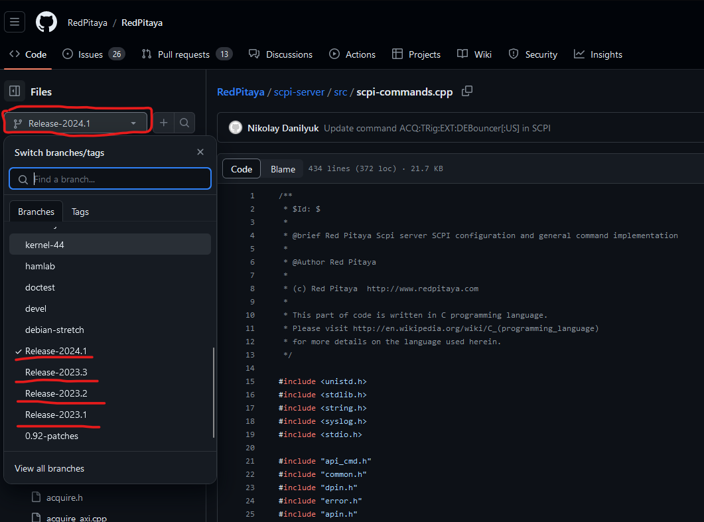

.. _command_list:

********************************************
List of supported SCPI & API commands
********************************************

Here is a list of all available SCPI, API, and JupyterLab commands. The commands are organized into tables by functionality. Each table row represents the same command in SCPI, Python API, 
C++ API, and JupyterLAB. The Jupyter commands are identical to Python API commands, so please refer to them. In the final two columns is a command description and ecosystem version in 
which the command first appeared.

At the beginning of each table are all command parameter options and available macros.

For API commands you can find a detailed description in these C++ header files:

* :rp-github:`Red Pitaya GitHub API header files <RedPitaya/tree/master/rp-api/api/include>`.

|

.. toctree::
    :caption: Command list
    :maxdepth: 1

    command_list/commands-init.rst
    command_list/commands-board.rst
    command_list/commands-digital.rst
    command_list/commands-analog.rst
    command_list/commands-pll.rst
    command_list/commands-daisy.rst
    command_list/commands-gen.rst
    command_list/commands-acq.rst
    command_list/commands-dmm.rst
    command_list/commands-lcr.rst
    command_list/commands-logic-analyzer.rst
    command_list/commands-uart.rst
    command_list/commands-spi.rst
    command_list/commands-i2c.rst
    command_list/commands-can.rst
    command_list/commands-status-leds.rst
    command_list/commands-temp-prot.rst
    command_list/commands-calibration.rst

|

**How to find all available SCPI commands per OS version?**

Use the ``SYSTem:Help?`` SCPI command, which lists all available SCPI commands.

You can also find all SCPI commands that the board will accept depending on the Red Pitaya OS version here:

* Latest Beta OS: |all_os_scpi_commands|.

For all other Red Pitaya OS versions, go to the link above and select the appropriate branch for your OS version. Use the **Tag** menu to find the correct branch for your OS version.

* 2.00-18 or higher - *(file ends in .cpp)*.
* 2.00-15 or older - |all_os_scpi_commands_2.00-15| *(file ends in .c)*.

.. |all_os_scpi_commands| replace:: :rp-github:`Red Pitaya GitHub - scpi-server/src/scpi-commands.cpp <RedPitaya/blob/master/scpi-server/src/scpi-commands.cpp>`

.. |all_os_scpi_commands_2.00-15| replace:: :rp-github:`Red Pitaya GitHub 2023.1- scpi-server/src/scpi-commands.c <RedPitaya/blob/Release-2023.1/scpi-server/src/scpi-commands.c>`

|

:ref:`Back to top <command_list>`
