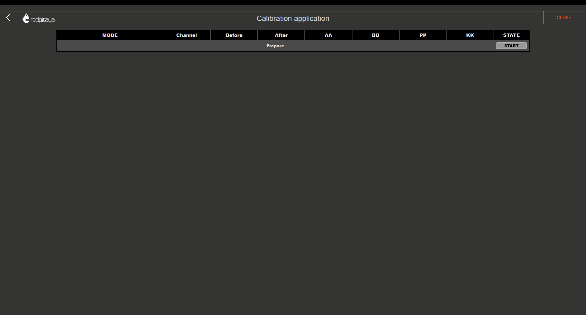
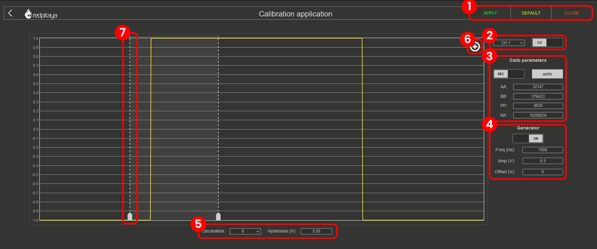

.. _frequency_calibration:

.. TODO: Screenshots in this page are outdated - update to new OS

######################
Frequency Calibration
######################

.. contents:: Table of Contents
    :local:
    :depth: 2
    :backlinks: top

|

**Purpose:** Frequency calibration compensates for component mismatches in the analog front-end resistor and capacitor divider circuits when 
switching between LV and HV voltage ranges. This ensures accurate amplitude measurements across the frequency spectrum by applying a digital correction filter in the FPGA.

.. note::

    While component matching could theoretically eliminate the need for frequency calibration, the filter approach enables mass production while 
    maintaining reasonable board costs, high accuracy and small form-factor.

|

Auto Frequency calibration
===========================

Auto Frequency calibration will guide you step-by-step through the calibration process and is the option we recommend for beginners.

**Step-by-step guide:**

Once the auto frequency calibration is started, you will be presented with the following window:

The header columns represent the following:

    * **MODE** - correlates to how the jumpers should be set.
    * **Channel** - indicates which channel the subsequent column settings apply to.
    * **Before and After** - values before and after the calibration.
    * **AA, BB, PP, and KK** - coefficients for the filter inside the FPGA that affects the inputs. For more details, please refer to the "Manual Frequency calibration" section.
    * **STATE** - displays the progression of the calibration process.

Please pay attention to the **STATE** column, as clickable buttons which progress the process will appear. 

1.  **LV calibration**:

    .. figure:: img/Calib_freq_auto_LV.png
        :align: center
        :width: 1200

    * Clicking on the "START" button will provide further instructions and a choice between an internal and external reference generator:

    .. figure:: img/Calib_freq_auto_LV_int.png
        :align: center
        :width: 600

    * Please select "INTERNAL" if you do not have an external reference generator. Red Pitaya will use OUT1 to generate a 0.9 Volt 1 kHz Square signal.
    * Set the jumpers to the LV position and connect OUT1 to IN1 and IN2 using the SMA cables and the T adapter.
    * Click on Calibrate button to start the calibration process.

    .. figure:: img/Calib_freq_auto_LV_ext.png
        :align: center
        :width: 600

    * Please configure the external reference generator to produce a 1 kHz square signal and input the "reference voltage" (one-way amplitude) of the signal.
    * Set the jumpers to the LV position and connect the output of the external generator to IN1 and IN2 of the Red Pitaya using SMA or BNC cables and the T adapter.
    * Click on Calibrate button to start the calibration process.

2.  **LV calibration in progress**:

    .. figure:: img/Calib_freq_auto_LV_load.png
        :align: center
        :width: 1200

    Please wait until the LV calibration is finished.

3.  **HV calibration**:

    .. figure:: img/Calib_freq_auto_HV.png
        :align: center
        :width: 1200

    * Change the jumpers to the HV position and choose the generator source.

    .. figure:: img/Calib_freq_auto_HV_int.png
        :align: center
        :width: 600

    .. figure:: img/Calib_freq_auto_HV_ext.png
        :align: center
        :width: 600

    * The external reference generator amplitude should be set to at least 10 V (up to ±20 V maximum) for HV calibration.

4.  **HV calibration in progress**:

    .. figure:: img/Calib_freq_auto_HV_load.png
        :align: center
        :width: 1200

    * Please wait until the HV calibration is finished.

5.  **Save calibration values**:

    .. figure:: img/Calib_freq_auto_save.png
        :align: center
        :width: 1200

6.  **Finish the calibration**:

    .. figure:: img/Calib_freq_auto_complete.png
        :align: center
        :width: 1200

    * Clicking on the "DONE" button will return you to the starting screen of the Calibration application.

|

Manual Frequency calibration
=============================

Manual Frequency calibration allows you to perform the calibration manually and fine-tune all the variables.
Apart from calibration, this option also allows you to identify any parasitics on your measurement lines.

The manual mode is intended for users who want to:

* verify or fine-tune the automatically generated coefficients,
* recover a channel with known non-ideal edge response,
* compensate for a specific measurement setup, or
* optimize the response at frequencies above the 1 kHz square-wave reference used by the automatic calibration.

**Interface elements:**

* **Settings menu** - *APPLY* the calibration parameters, restore the *DEFAULT* parameters, *DISABLE* the frequency calibration filter, or *CLOSE* the manual frequency calibration.
* **Channel & Jumper settings** - Choose a channel and voltage range (LV or HV depending on the jumper settings) to calibrate.
* **Calibration parameters** - Choose between *DEC* and *HEX* values, click on *AUTO* to perform an automatic frequency calibration, and input the FPGA filter coefficients (AA, BB, PP, KK).
* **Generator settings** - Turn the internal generator (OUT1) *ON* and *OFF*. The frequency, one-way amplitude, and offset cannot be changed.
* **Decimation & Hysteresis** - Change the decimation and hysteresis.
* **Edge zoom** - Zoom in on the square waveform edge for better calibration.
* **Cursors** - Can be moved to observe the positive or negative edge, and the white area in-between represents the zoom-in area.

For technical details about the FPGA filter coefficients, see the :ref:`Technical Reference section <fpga_filter_math>`.

| 

Manual tuning workflow
----------------------

The frequency equalization filter is a digital correction filter applied in the FPGA after the ADC. It compensates for the analog front-end response of each channel 
and gain path.

The four coefficients do not have equal importance during manual tuning:

* **AA** and **BB** are the main equalization coefficients. They primarily determine the shape of the step response and therefore have the strongest effect on 
  overshoot, undershoot, ringing and settling.
* **PP** is a secondary pole used mainly to trim the remaining amplitude and residual settling once **AA** and **BB** are already close.
* **KK** is the overall scaling term. It is normally used last, as a final gain trim.

In practice, the recommended order is:

1. start from the current or default coefficient set,
#. tune **AA** and **BB** together while watching the square-wave edge,
#. use **PP** to correct the remaining amplitude error,
#. use **KK** only for the final gain correction.

| 

Step-by-step manual tuning procedure
------------------------------------

The procedure below can be used for either LV or HV calibration. Repeat it separately for each channel and for each gain path.

1.  **Prepare the board**

    * Open the *Calibration* application and select **Manual Frequency Calibration**.
    * Select the channel to be calibrated.
    * Set the input jumpers to the correct gain range (**LV** or **HV**) and select the same range in the application.
    * If you are calibrating an original generation board, use the same impedance conditions as in your real measurement setup. If the setup normally 
      uses 50 Ω termination, keep that termination during calibration as well.

2.  **Connect a square-wave reference**

    * For a quick baseline, turn the internal generator **ON** and connect **OUT1** to the selected input.
    * For best repeatability, use a clean external square-wave generator.
    * Use approximately **0.9 V one-way amplitude** in **LV** mode and at least **10 V** in **HV** mode.
    * Begin at **1 kHz**, which is the same reference used by the automatic calibration.

3.  **Load a safe starting point**

    * If the channel was previously calibrated, start from the current values and note them down.
    * If the response is badly distorted, click **AUTO** first or restore the default values, then return to manual mode.
    * If you want to temporarily remove the equalization effect, use the disabled filter values described in :ref:`Disabling frequency calibration filter <disable_frequency_filter>`.

4.  **Set up the display for edge inspection**

    * Enable **Edge zoom**.
    * Position the cursors around one transition edge so that the rising or falling edge fills most of the zoom area.
    * Adjust **Decimation** and **Hysteresis** until the edge is stable and easy to compare while changing coefficients.

5.  **Tune AA and BB first**

    * Change **AA** and **BB** in small steps.
    * After each change, wait for the displayed waveform to settle and compare the edge shape.
    * The goal is to minimize:

      * overshoot above the final value,
      * undershoot below the final value,
      * ringing after the transition, and
      * slow settling to the final plateau.

    * A practical rule is to move only one parameter at a time until the trend is clear, then make smaller alternating adjustments of **AA** and **BB**.

6.  **Trim PP for amplitude and residual settling**

    * Once the edge shape is close, adjust **PP**.
    * Use **PP** to correct the remaining amplitude error and to reduce any small amount of residual edge distortion that remains after **AA** and **BB** are tuned.
    * If changing **PP** causes the edge shape to degrade significantly, return to the previous value and continue with smaller **AA/BB** adjustments instead.

7.  **Use KK for final gain correction**

    * After the edge shape and settling are acceptable, adjust **KK** so that the measured amplitude matches the reference signal.
    * **KK** should normally be the last parameter changed because it scales the whole response without improving the fundamental edge correction.

8.  **Apply and save the result**

    * Click **APPLY** to write the values to the user calibration area.
    * Repeat the same process for every channel and for both **LV** and **HV** modes if required.

| 

What to change when the waveform looks wrong
--------------------------------------------

The exact best direction depends on the board and channel, but the following heuristics are useful while tuning:

* **Large overshoot or ringing** usually means the equalization is too aggressive. First reduce the strength of the **AA/BB** correction and re-check the edge.
* **A rounded or slow edge** usually means the equalization is too weak. Increase the **AA/BB** correction gradually until the edge becomes steeper without introducing excessive ringing.
* **Correct edge shape but wrong amplitude** is usually a **PP** or **KK** problem. Try **PP** first, then finish with **KK**.
* **Correct low-frequency amplitude but poor high-frequency response** usually means the edge shaping coefficients **AA** and **BB** still need refinement.

If a change makes the waveform worse in every way, revert it immediately and continue with smaller steps.

| 

Manual calibration above 1 kHz
-------------------------------

The automatic calibration uses a **1 kHz square wave** because it provides a stable and repeatable step response for finding the basic equalization 
coefficients. This does **not** mean the filter is valid only at 1 kHz. The edge of a square wave contains high-frequency content, so the 1 kHz 
reference is used mainly as a convenient way to optimize the transient response.

For applications that require the best accuracy at higher frequencies, use the following two-stage method:

1.  **First establish a stable baseline at 1 kHz**

    * Run automatic calibration or manual edge tuning at 1 kHz.
    * Save the resulting coefficient set as the baseline for that channel and gain path.

2.  **Then refine manually at the target frequency range**

    * Replace the 1 kHz square wave with an external generator set to one or more frequencies near your real operating range.
    * Prefer a sine wave when checking amplitude flatness and a square wave when checking edge shape and ringing.
    * Measure at several points across the intended operating band, for example low, mid and high frequency.

The recommended refinement order is:

1.  keep **KK** fixed at first,
#. adjust **AA** and **BB** slightly while watching the highest-frequency waveform that still has a reliable amplitude and shape,
#. re-check the lower-frequency points to confirm that the correction did not become too aggressive,
#. use **PP** to trim remaining amplitude error across the band,
#. use **KK** for the final overall gain correction.

In other words, the 1 kHz calibration should be treated as the starting point, not the final authority, when the board will be used at much higher frequencies.

.. note::

    It is normal for a coefficient set optimized for the cleanest 1 kHz square-wave edge to be slightly different from a set optimized for minimum 
    amplitude error at the upper end of the bandwidth. The best choice depends on whether your application prioritizes transient fidelity, amplitude 
    flatness, or both.

.. tip::

    For high-frequency refinement, record the amplitude error at several frequencies before changing any coefficient. Then change only one coefficient 
    group at a time and compare the full set of measurements again. This avoids optimizing one frequency point while degrading the rest of the band.

| 

Suggested high-frequency validation procedure
---------------------------------------------

After manual tuning, validate the result with an external generator:

1.  Apply a sine wave at several frequencies across the intended operating band.
#. Record the measured amplitude on the calibrated channel.
#. Compare it to the generator setting or to a trusted reference instrument.
#. Repeat with a square wave near the upper part of the operating band to check for reintroduced overshoot or ringing.
#. If needed, return to manual mode and make only small corrections from the saved baseline.

This validation step is especially important when the calibration is being optimized for a narrow high-frequency application rather than for 
general-purpose oscilloscope use.

|

.. _disable_frequency_filter:

Disabling frequency calibration filter
=======================================

To disable the frequency calibration filter, follow these steps:

1.  Open the Calibration application from the *System Tools* menu.
2.  Click on the **Manual Frequency Calibration** option.
3.  Click on the **Disable** button in the settings menu. Repeat the process for each input channel and each voltage range (LV and HV).
4.  If you are using an older OS interface, you can disable the frequency calibration filter by inputing the following calibration parameters:

    * AA = 0
    * BB = 0
    * PP = 0
    * KK = 16777215 (or 0xFFFFFF in hexadecimal)

.. note::

    These values effectively create a unity gain filter with no phase correction, which is equivalent to bypassing the frequency calibration.

|

.. _fpga_filter_math:

Technical Reference
===================

FPGA Filter Mathematics
-----------------------

The frequency calibration uses a digital filter implemented in the FPGA to compensate for analog component mismatches. The filter is defined by 
four coefficients: **AA**, **BB**, **PP**, and **KK**.

Functionally, the filter can be interpreted as:

* one zero controlled by **BB**,
* two recursive poles controlled by **AA** and **PP**,
* a pipeline delay of four samples, and
* an overall gain term controlled by **KK**.

This is why **AA** and **BB** dominate the edge shape, while **PP** and **KK** are typically used later as correction terms.

**Filter Transfer Function:**

.. math::

    H[z] = \frac{K \cdot (z - B)}{z^4 \cdot (z - P) \cdot (z - A)}

|

**Where:**

* :math:`K = \frac{KK}{2^{24}}`
* :math:`B = 1 - \frac{BB}{2^{28}}`
* :math:`P = \frac{PP}{2^{16}}`
* :math:`A = 1 - \frac{AA}{2^{25}}`

Coefficient summary:

* **AA** - main pole term. Primarily affects settling time and ringing.
* **BB** - zero term. Primarily affects high-frequency pre-emphasis and edge sharpness.
* **PP** - secondary pole term. Mainly used for amplitude trim and residual settling adjustment.
* **KK** - overall gain scaling term.

**MATLAB Simulation Code:**

The following MATLAB code simulates the frequency response of the FPGA filter:

.. code-block:: matlab
    
    clc
    close all
    clear

    % Filter parameters %
    aa_hex = '7D93'
    bb_hex = '437C7'
    pp_hex = '2666'
    kk_hex = 'D9999A'

    aa = hex2dec(aa_hex)
    bb = hex2dec(bb_hex)
    pp = hex2dec(pp_hex) 
    kk = hex2dec(kk_hex)

    % H[z]=K*(z-B) / (z^4*(z-P) * (z-A))
    % where:
    % K = KK / 2^24
    % B = 1 - (BB / 2^28)
    % P = PP / 2^16
    % A = 1 - (AA / 2^25)

    fs = 125e6;
    f = 0:1e3:fs;

    z = exp(j*2*pi*f/fs);

    k = kk/(2^24);
    b = 1-(bb/2^28);
    p = pp/2^16;
    a = 1-(aa/2^25);

    h = k*(z-b)./(z.^4.*(z-p).*(z-a));

    % Figure
    % plot(f,20*log10(abs(h)))
    figure
    semilogx(f, 20*log10(abs(h)))
    title(strcat('Frequency response for AA=',aa_hex,' BB=',bb_hex,' PP=',pp_hex,' KK=',kk_hex))
    xlabel('frequency (Hz)')
    ylabel('gain (dB)')

|
