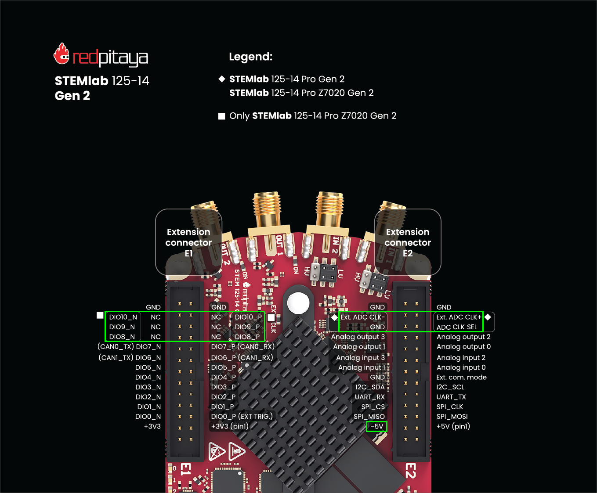
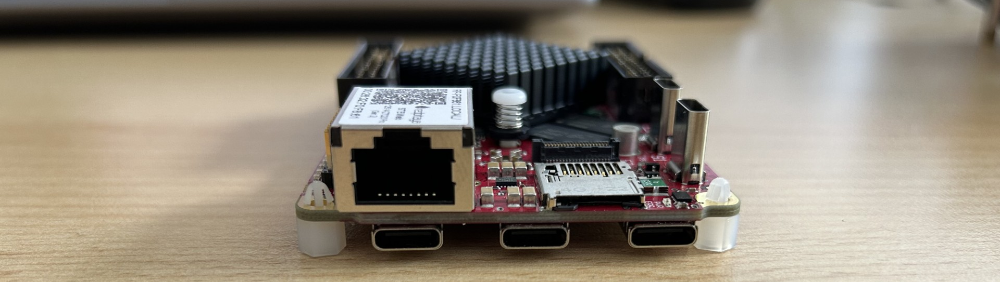
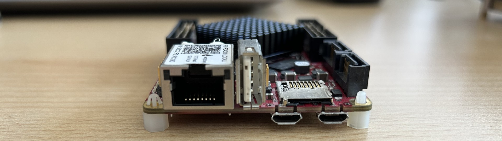
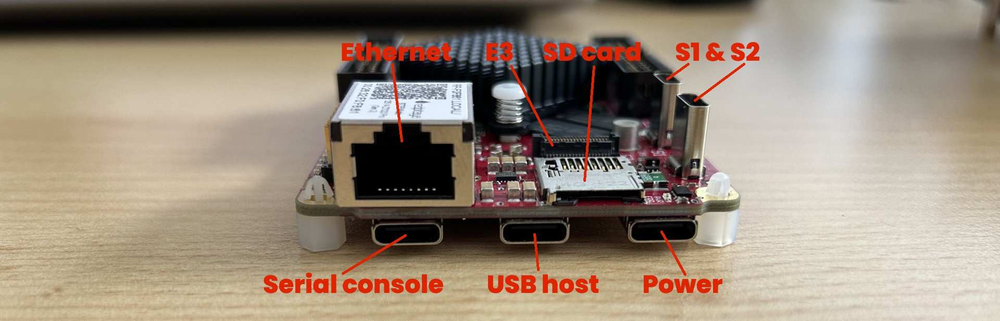
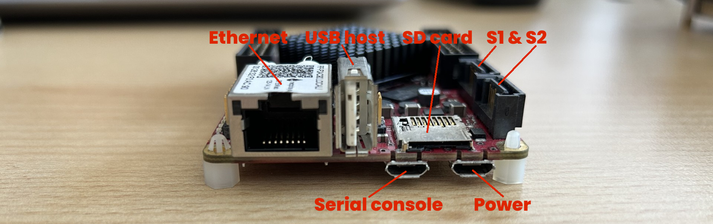

.. _migration_guide_og_gen2:

##############################
Migration Guide (Gen 2)
##############################

This guide explains how to migrate from original-generation Red Pitaya hardware to Gen 2. It covers the key hardware differences and the adjustments 
needed for a smooth transition.

.. contents:: Table of Contents
   :local:
   :depth: 2

|

Introduction
=============

Following the planned discontinuation of the original :ref:`STEMlab 125-14 <top_125_14>` and its variants at the end of 2026, users may need to migrate 
to one of the newer Red Pitaya platforms. This guide describes the key hardware differences to consider when migrating from an original-generation 
:ref:`STEMlab 125-14 <top_125_14>` to a :ref:`STEMlab 125-14 Gen 2 <top_125_14_gen2>` or another Gen 2 product.

|

When to use this guide
========================

Use this guide if your product currently uses one of the following original-generation Red Pitaya boards:

* :ref:`STEMlab 125-14 <top_125_14>`
* :ref:`STEMlab 125-14 Ext. Clk. <top_125_14_EXT>`
* :ref:`STEMlab 125-14 Low Noise <top_125_14_LN>`
* :ref:`STEMlab 125-14 Z7020 Low Noise <top_125_14_Z7020_LN>`
* :ref:`STEMlab 125-14 X-channel system (original) <top_125_14_MULTI>`

This guide applies when migrating to one of the following second-generation Red Pitaya boards:

* :ref:`STEMlab 125-14 Gen 2 <top_125_14_gen2>`
* :ref:`STEMlab 125-14 PRO Gen 2 <top_125_14_pro_gen2>`
* :ref:`STEMlab 125-14 PRO Z7020 Gen 2 <top_125_14_pro_z7020_gen2>`

.. note::

    The following boards and their variations are **not** planned for discontinuation in the foreseeable future and are therefore not covered by 
    this migration guide:

    * :ref:`SDRlab 122-16 <top_122_16>`
    * :ref:`SIGNALlab 250-12 <top_250_12>`
    * :ref:`STEMlab 125-14 4-Input <top_125_14_4-IN>`
    * TI boards and other Gen 2 products

|

Changes to the pinout
=======================

Although the pinout changes between the original and second-generation boards are limited, some of them may affect existing hardware designs and 
extension boards. Review the pinout carefully before replacing an original-generation board with a Gen 2 board.

The relevant changes are labeled in the figure above and described in detail in the following sections.

|

External clock input
----------------------

The position and voltage range of the external clock connection remain unchanged. However, Gen 2 boards include an additional **ADC CLK SEL** pin that 
selects the clock source. On original-generation boards, this pin is labeled GND. On Gen 2 boards, the clock source is selected according to the voltage 
level applied to the **ADC CLK SEL** pin:

* **GND** - Selects the external clock supplied through the **EXT ADC CLK±** pins.
* **3V3** or **floating (NC)** - Selects the internal oscillator.

As a result, a Gen 2 board may automatically operate in external-clock mode when connected to an extension board designed for an original-generation board, 
because the corresponding pin on the extension board is connected to GND. If your design integrates a Red Pitaya board or uses an extension board 
and depends on the internal Red Pitaya clock, modify the design to account for the new ADC CLK SEL pin and its function. Ensure that the pin is 
held at 3V3 or left floating/NC, as appropriate for the system design.

|

Negative power supply
----------------------

The negative supply voltage is -3.4 V on original-generation boards and -5 V on Gen 2 boards. This change may damage connected components or alter their 
operating behavior if they are not rated for the new voltage. Review all circuitry connected to the negative supply before migrating to a Gen 2 
board.

|

GPIO voltage levels on Z7020 models
-------------------------------------

Red Pitaya models based on the Zynq-7020 SoC provide six additional GPIO pins on the E1 extension connector (DIO8, DIO9, and DIO10). The voltage 
levels for these pins differ between generations:

* **Original-generation boards** - 3.3 V logic levels
* **Gen 2 boards** - 2.5 V logic levels

All other GPIO pins on the E1 connector remain at 3.3 V, regardless of the board generation. The DIO8, DIO9, and DIO10 pins are connected to Bank 13 
of the Zynq-7020 FPGA. This bank is shared with the differential GPIO pairs (DIO11-DIO18) on the E3 connector.

.. note::

    Red Pitaya boards use differential-pair naming for all GPIO signals, with one signal labeled P and the other labeled N. For example, DIO8 
    collectively refers to DIO8_P and DIO8_N. By default, all GPIOs operate as single-ended signals.

|

Changing the voltage level of Zynq-7020 FPGA Bank 13
-------------------------------------------------------

The voltage level of Zynq-7020 FPGA Bank 13 can be changed from 2.5 V to 3.3 V. This changes the logic levels of:

* **DIO8-DIO10** on E1 extension connector
* **DIO11-DIO18** (fast differential pairs) on E3 extension connector

.. note:: 
    
    The 2.5 V logic level used for the fast differential lines was selected to support higher communication speeds. Changing Bank 13 to 
    3.3 V may reduce communication performance.

Hardware modifications are required to change the voltage level of Bank 13. For information about the modification procedure and compatibility 
requirements, contact support@redpitaya.com.

|

Connector locations and types
===============================

Some connectors have been relocated or replaced with different connector types. Although these changes do not directly affect the board's functionality, 
they may affect mechanical designs that integrate Red Pitaya boards.

    Back view of the STEMlab 125-14 PRO Gen 2 board.

    Back view of the original-generation STEMlab 125-14 board.

As shown in the comparison of the rear sides of the :ref:`STEMlab 125-14 PRO Gen 2 <top_125_14_pro_gen2>` and the original-generation 
:ref:`STEMlab 125-14 <top_125_14>`, the following connectors have changed:

1. **S1 and S2 connectors** - SATA to USB-C
2. **Power connector** - Micro-USB to USB-C
3. **Serial console connector** - Micro-USB to USB-C
4. **USB host connector** - USB-A to USB-C
5. **E3 connector** - Not available on original-generation boards; available on Gen 2 boards

In addition, several connectors, including the SD card slot, have moved slightly. See the figures below for comparison.

    Back view of the STEMlab 125-14 PRO Gen 2 board with labelled connectors.

    Back view of the original-generation STEMlab 125-14 board with labelled connectors.

For exact connector locations and board dimensions, refer to the 3D board models available in the :ref:`Hardware section of the Developers Guide <dev_guide_hardware>`.

|

Synchronisation on Gen 2
==========================

On Gen 2 boards, the recommended method for synchronising multiple Red Pitaya boards has changed from the **S1 and S2** connectors to the 
**EXT ADC CLK±** interface for improved stability.

The primary reason for this change is improved synchronisation stability. :ref:`Red Pitaya Click Shields <click_shield>` include clock 
buffers, which prevent the clock and trigger signals from degrading each time they pass through an FPGA. This degradation can occur when using 
S1 and S2 for synchronization. Use the **EXT ADC CLK±** pins on the E2 connector instead of the **S1 and S2** connectors for new synchronization 
designs.

.. note::

    Synchronisation through the **S1 and S2** connectors remains possible on Gen 2 boards but requires a hardware modification to the board.

|

Migration checklist
====================

Before replacing an original-generation board with a Gen 2 board:

1. Review the complete connector pinout.
#. Verify the behavior of the **ADC CLK SEL** pin.
#. Confirm that the required clock source is selected correctly.
#. Check all circuitry connected to the negative supply and confirm that it supports -5 V.
#. For Z7020 models, verify the required logic levels for **DIO8–DIO10** and **DIO11–DIO18**.
#. Confirm whether changing Zynq-7020 FPGA Bank 13 to 3.3 V will affect signal integrity or communication speed.
#. Review the connector types and locations, including the SD card slot.
#. For multi-board systems, use the **EXT ADC CLK±** interface for synchronization where possible.
#. Test the complete system with the Gen 2 board before deploying it in production.

For additional information about migration, contact support@redpitaya.com.
