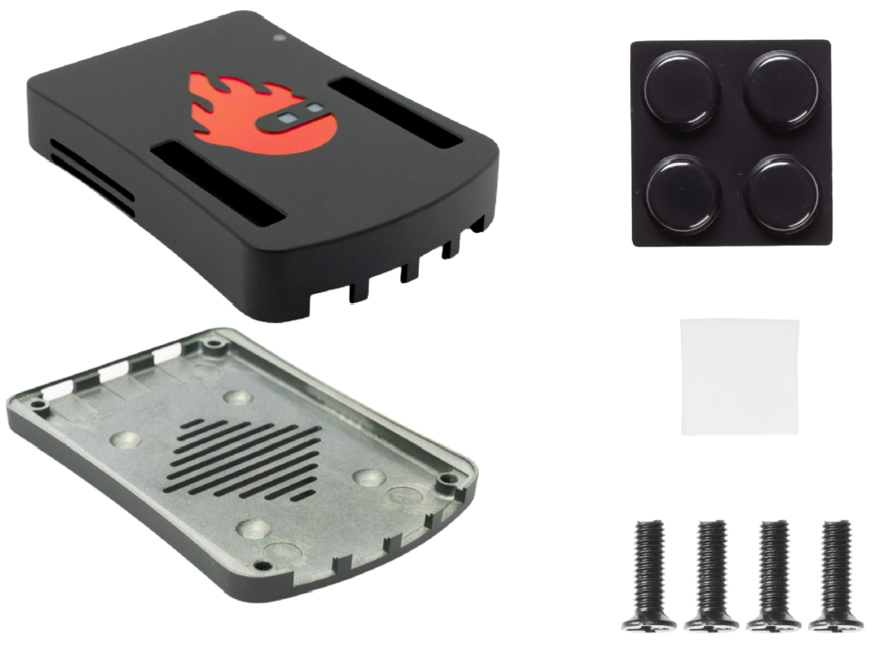
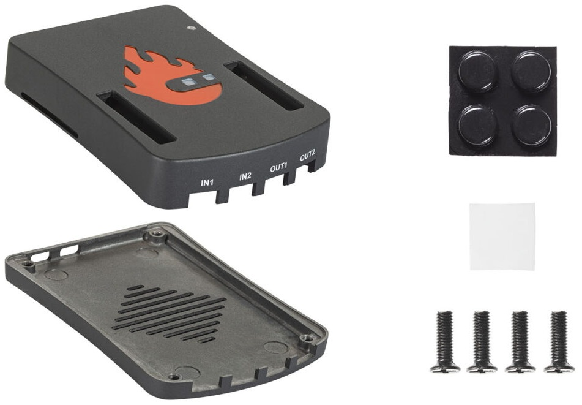
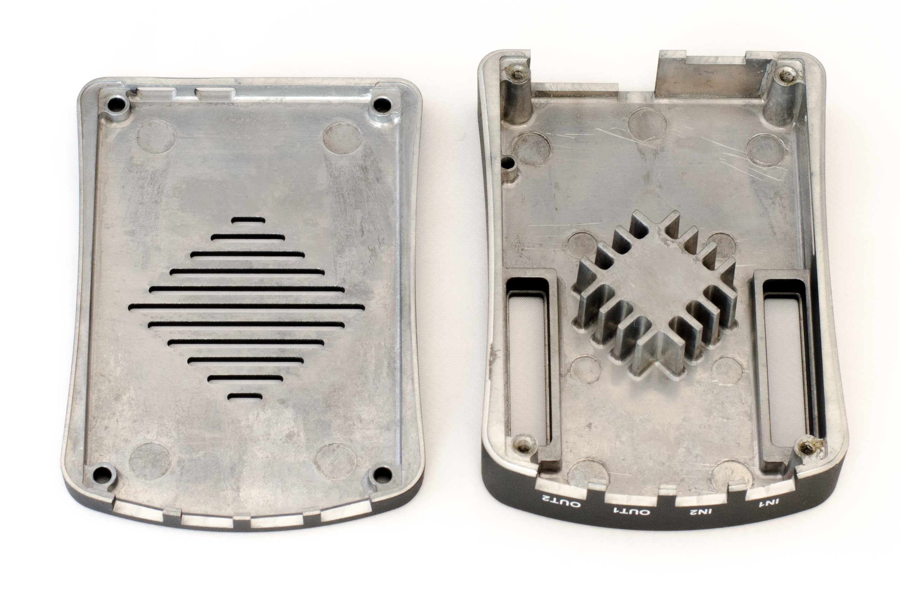
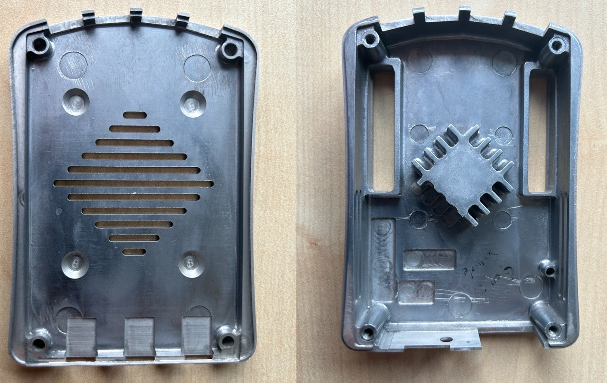
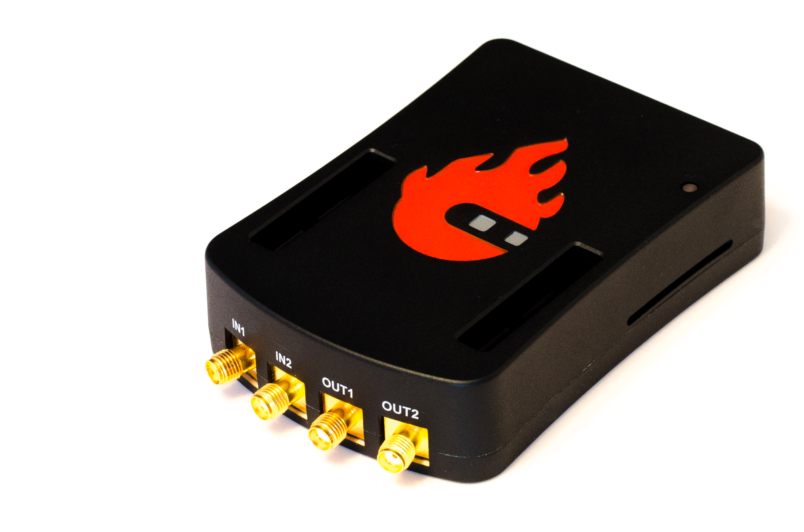
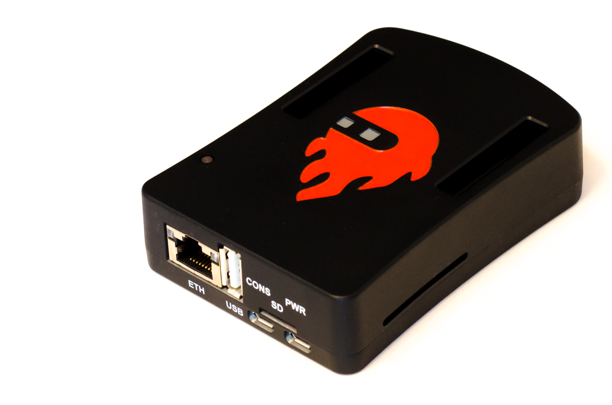
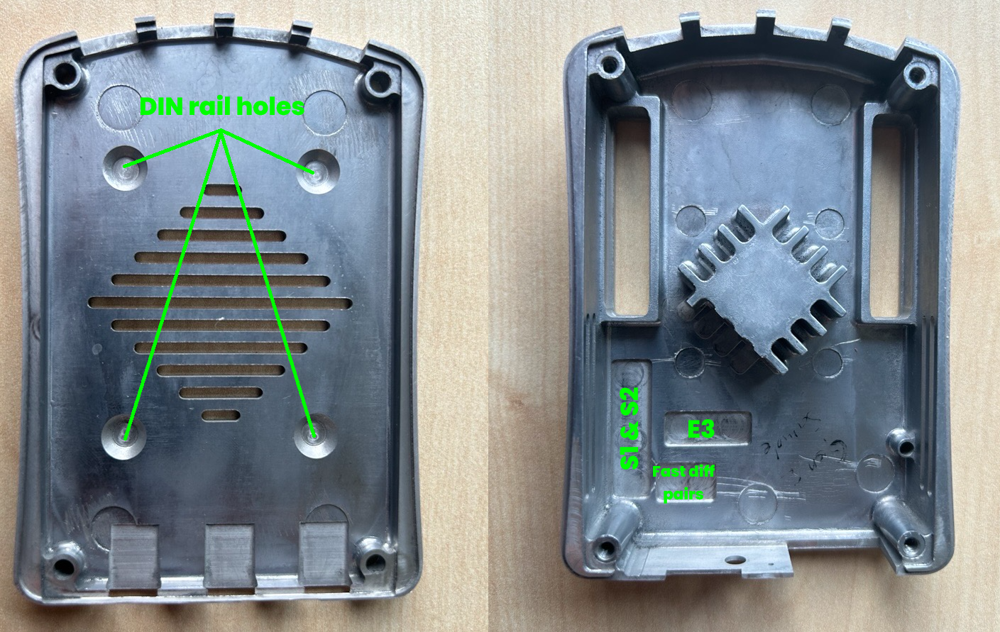
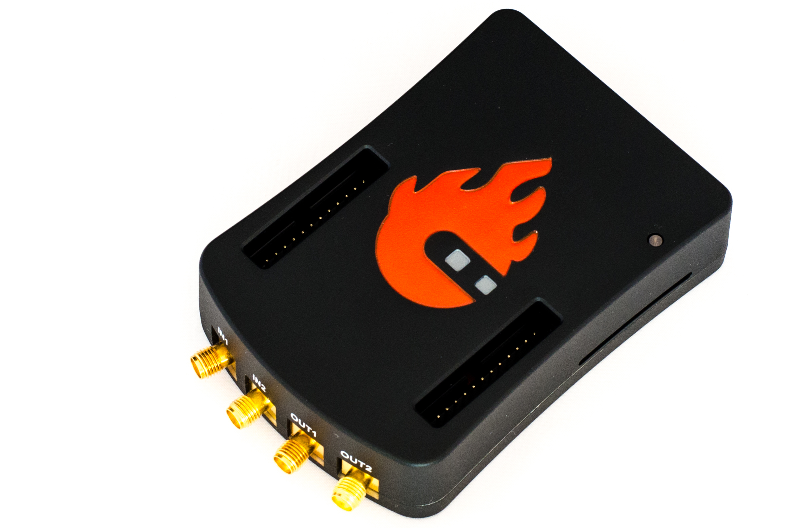

.. _alucase:

##################################
Red Pitaya Aluminium Case Assembly
##################################

Whether you bought your Red Pitaya aluminium case in a kit or as a separate add-on, you will need to assemble it by hand.

The aluminium case comes in two flavours:

* Aluminium case Gen 2
* Aluminium case (original)

Compatibility
==================

Aluminium case Gen 2
----------------------

The second generation aluminium case is compatible with the following Red Pitaya boards and their variations:

* STEMlab 125-14 PRO Z7020 Gen 2
* STEMlab 125-14 PRO Gen 2
* STEMlab 125-14 Gen 2

Aluminium case (original)
--------------------------

The aluminium case (original) is compatible with the following Red Pitaya boards and their variations:

* STEMlab 125-14.
* SDRlab 122-16.
* STEMlab 125-14 4-Input.
* STEMlab 125-10.

.. note::
    The original aluminium case is not compatible with the second generation Red Pitaya boards.

|

Components
============

    Components of the Red Pitaya aluminium case.
    
Contents:

    * 4 screws to close the case and hold the board in place
    * 4 rubber feet for secure positioning on the desk
    * A thermal pad (barely visible in the photo)
    * A transparent plastic rod that directs the light of a red LED (Ready/CPU activity) to the top of the case.

   The inside of the Red Pitaya aluminium case (original).

    The inside of the Red Pitaya aluminium case Gen 2.
    
The inside of the Red Pitaya aluminium case is designed to efficiently dissipate the heat by connecting directly to the Zynq 7000 FPGA SoC and contains opennings for air circulation 
on the bottom side and the side of the case.

|

Backdrilled holes (Gen 2 aluminium case)
=========================================

There are opennings for E1 and E2 expansion ports on the top side of the case. Gen 2 version also includes backdrilled holes for:

* DIN rail mounting (bottom side)
* E3 expansion port and QSPI eMMC fast differential connector (top side)
* S1 and S2 synchronisation connectors (top side)

    Backdrilled holes in the Gen 2 aluminium case.

|

Assembly Instructions
=======================

#. Remove the small plastic feet by pressing on the clips at the top with a small pair of pliers and pushing the feet down.
   
    .. figure:: img/rp_alucase_07.jpg
        :align: center
        :width: 600
      
        The underside of the Red Pitaya board showing the plastic feet.

#. Repeat the procedure for the STEMlab 125-14 with the heat sink, pressing the clips together at the bottom and gently pushing the holder upwards.
   
#. The heat sink of the STEMlab 125-10 is glued to the FPGA. Turn the heatsink slightly, as shown in the picture below, until it comes loose.

    .. figure:: img/STEMlab_10_heatsink.png
        :align: center

    .. figure:: img/rp_alucase_08.jpg
        :align: center
        :width: 600
   
        The top of the Red Pitaya board with the heat sink removed.

#. Remove the rest of the thermal compound.

#. Apply the thermal pad to the CPU.

#. Place the Red Pitaya board in the lower part of the case.

#. Turn the top of the case upside down and place the light guide plastic in place.

#. Close it with the bottom part of the case, including the Red Pitaya board. Make sure the holes in the board and the housing are aligned.

#. Replace the four screws.

#. Replace the rubber feet.

