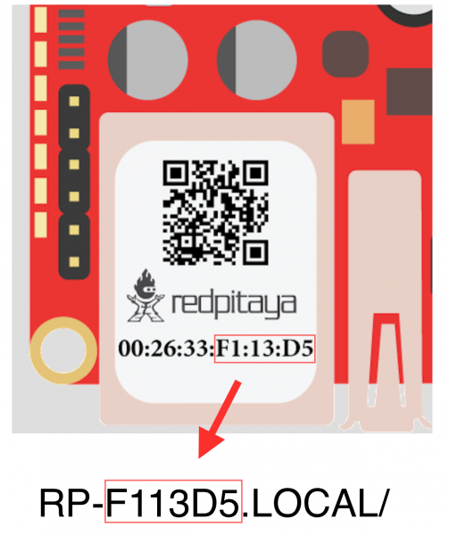
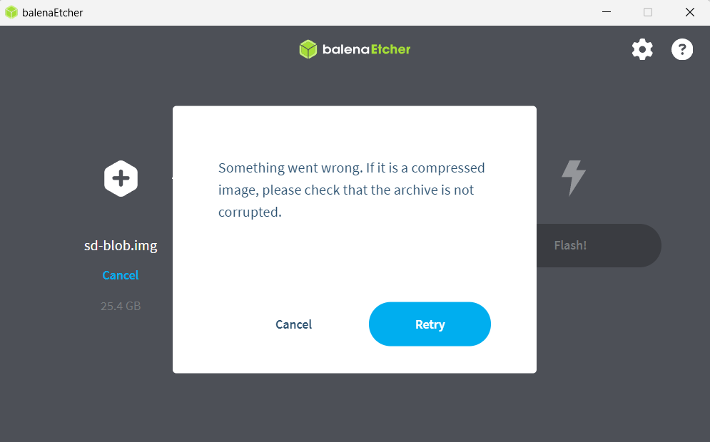
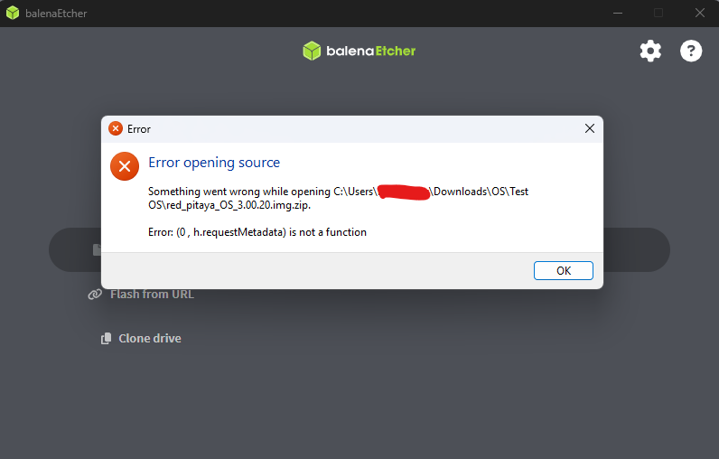
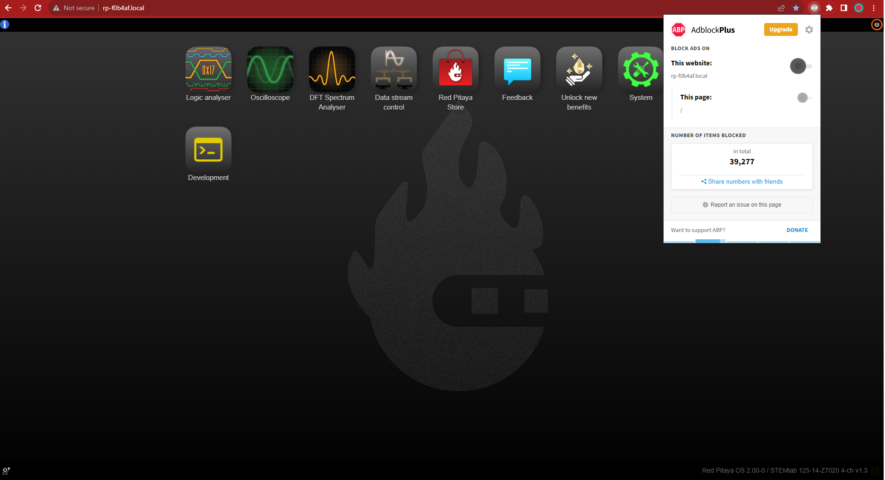

.. _faq:

######
FAQ
######

Use this page as the main entry point for common Red Pitaya questions. If your board is not booting, keeps rebooting, is not reachable over the network, or the cause of the 
problem is still unclear, start with the :ref:`Troubleshooting procedure <troubleshooting>` first and then return to the specific FAQ topics below if needed.

.. contents:: On this page
    :local:
    :depth: 2

.. note::

    Not found what you are looking for? Please :ref:`contact us <report_problem>`. Please include all the relevant information regarding the problem.
    For easier debugging on OS versions 2.00 and above, please also include the :ref:`Downloaded system report <system_info>` in the bottom left corner 
    of your Red Pitaya main webpage.

|

Start here
============

Use the links below in this order:

1. If the problem is not yet clear, follow the :ref:`Troubleshooting procedure <troubleshooting>`.
2. If you already know the category of the problem, jump to the relevant FAQ section on this page.
3. If the topic is product-specific or version-specific, use the dedicated reference pages listed under :ref:`Specialized FAQ and reference pages <specialized_faq_pages>`.

The troubleshooting guide is the correct starting point for:

* boards that do not boot,
* boards that keep rebooting,
* missing web interface or SSH access,
* unclear hardware or software faults,
* cases where you are not yet sure whether the issue is caused by the board, network, OS, or application.

|

Common FAQ topics
===================

These sections answer frequently asked questions once the general problem category is known.

* :ref:`Connectivity <faq_connectivity>` - network setup, local access, Wi-Fi, and hostname questions.
* :ref:`OS <faq_os>` - OS update, installation, and recovery questions.
* :ref:`Applications & Web Interface <faq_apis_interface>` - application behavior, calibration, and browser-side issues.
* :ref:`Software <faq_sw>` - remote control, FPGA development, repositories, and Python packages.
* :ref:`Hardware <faq_hw>` - schematics, board differences, calibration, and bandwidth.
* :ref:`How to report a problem? <report_problem>` - what information to send to support.

|

.. _specialized_faq_pages:

Specialized FAQ and reference pages
====================================

Keep these pages separate from the general FAQ. They are useful when you already know you need board-specific, API-specific, or advanced-reference information.

* :ref:`Software troubleshooting <sw_troubleshooting>` - OS compatibility notes and known software issues.
* :ref:`Known hardware issues (Original Gen) <known_hw_issues_orig_gen>` - Original Gen hardware bugs and workarounds.
* :ref:`Known hardware issues (Gen 2) <known_hw_issues_gen2>` - Gen 2 hardware issue tracking and design notes.
* :ref:`SCPI & API known issues <commands_known_issues>` - command changes and API issues by OS version.
* :ref:`Multiboard synchronisation FAQ <faq_multiboard>` - X-channel system and Click Shield questions.
* :ref:`Gen 2 FAQ <faq_gen2>` - Gen 2-specific hardware, clocking, synchronisation, and E3 questions.

|

.. _app_troubleshooting_section:

Application-specific troubleshooting
======================================

Some applications have their own dedicated troubleshooting sections:

* **Streaming application** - See :ref:`data streaming limitations <streaming_limits>` for performance issues and maximum data rates
* **Playback & Record application** - See the dedicated Troubleshooting section in :ref:`Playback & Record documentation <playback&record>` for trigger errors and buffer configuration

|

.. _faq_connectivity:

Connectivity
==============

How to get started with Red Pitaya?
------------------------------------

    * :ref:`Quick start <quick_start>`.

How to connect to Red Pitaya in a few simple steps?
----------------------------------------------------

    * :ref:`Connected to router <LAN>`.
    * :ref:`Direct connection to computer <dir_cab_connect>`.

Red Pitaya not booting anymore?
---------------------------------

If the board no longer boots, follow the :ref:`Troubleshooting procedure <troubleshooting>`.

After that, the two most relevant follow-up checks are:

    * If the issue started after an update, review the :ref:`OS FAQ <faq_os>` section.

.. _faq_rebooting:

Red Pitaya is constantly rebooting?
------------------------------------

If the board keeps resetting during boot, first go through the :ref:`Troubleshooting procedure <troubleshooting>` to rule out general startup issues.

A board reset during boot-up is indicated by the green and blue LEDs lighting up, followed by the orange and red LEDs pausing their blinking to remain ON for about 2 seconds, then the cycle repeats. 
Repeated board resets suggest an **external clock signal is missing** (not connected) on the **external clock board** variations. Check the external clock specifications and instructions for your 
Red Pitaya board model:

    * :ref:`STEMlab 125-14 Gen 2 <top_125_14_gen2>`.
    * :ref:`STEMlab 125-14 External clock <top_125_14_EXT>`.
    * :ref:`SDRlab 122-16 External clock <top_122_16_EXT>`.

.. note::

    We have removed the external clock presence check from the OS boot sequence in OS 2.07-48 and higher. The board will boot without an external clock signal, but the FPGA will not be 
    able to operate properly. Please check the external clock specifications and instructions for your Red Pitaya board model.

.. _faq_clock_specifications:

How to connect the external clock to Red Pitaya?
-------------------------------------------------

The external clock signal is used to provide the main clock for the ADC, DAC and FPGA on Red Pitaya. Note that this is **not an External Reference Clock** that is used for the frequency 
reference of the ADC and DAC, but rather the main clock signal that drives the entire system. 

Here is a list of boards that support an **External Reference Clock**:

* :ref:`SIGNALlab 250-12 <top_250_12>` - SMA port on the back of the board is used to supply the 10 MHz External Reference Clock signal to the board.
* :ref:`STEMlab 65-16 TI <top_65_16_TI>` - clock synthesizer is used to generate the main clock for the ADC, DAC and FPGA from the External Reference Clock.
* :ref:`STEMlab 125-14 TI <top_125_14_TI>` - clock synthesizer is used to generate the main clock for the ADC, DAC and FPGA from the External Reference Clock.

The main ADC and FPGA CLK signal can be supplied from an external source through the **Ext. ADC Clk±** ports on the :ref:`E2 <E2_gen2>` connector.
The external clock signal should have the following specifications:

* **Differential LVDS signaling**
* **Power supply:** 3V3
* **Connector:** Pins 23 (Clk+) and 24 (Clk-) on E2 connector

.. note::

    The Red Pitaya FPGA is designed, tested, and guaranteed to operate correctly at the board's specified core clock frequency 
    (125 MHz for STEMlab 125-14, 122.88 MHz for SDRlab 122-16, etc).
    
    While it is possible to run the board at different clock frequencies, please be aware that:
    
    - The FPGA may not function as intended at non-standard frequencies and requires thorough testing
    - The ADC and DAC sampling rates will change proportionally with the clock frequency
    - Lower clock frequencies will reduce the analog bandwidth of the board
    - Red Pitaya does not guarantee proper operation at frequencies other than the specified core clock
    
    The board will boot with any valid external clock signal. 2.07-48 and higher OS versions do not block boot-up if the external clock is absent.

For exact voltage levels and timing requirements, please refer to the board specifications and schematics for your Red Pitaya board model:

    * :ref:`STEMlab 125-14 Gen 2 <top_125_14_pro_gen2>`.
    * :ref:`STEMlab 125-14 & STEMlab 125-14-Z7020 External clock <top_125_14_EXT>`.
    * :ref:`SDRlab 122-16 External clock <top_122_16_EXT>`.

.. _faq_internetAccess:

How can I make sure that my Red Pitaya has access to the internet?
--------------------------------------------------------------------

1.  Connect to your Red Pitaya over :ref:`SSH <ssh>`.
2.  Make sure that you can ``ping google.com`` website:

    .. code-block:: console

        root@rp-f03dee:~# ping -c 4 google.com
        PING google.com (216.58.212.142) 56(84) bytes of data.
        64 bytes from ams15s21-in-f142.1e100.net (216.58.212.142): icmp_seq=1 ttl=57 time=27.3 ms
        64 bytes from ams15s21-in-f142.1e100.net (216.58.212.142): icmp_seq=2 ttl=57 time=27.1 ms
        64 bytes from ams15s21-in-f142.1e100.net (216.58.212.142): icmp_seq=3 ttl=57 time=27.1 ms
        64 bytes from ams15s21-in-f142.1e100.net (216.58.212.142): icmp_seq=4 ttl=57 time=27.1 ms

        --- google.com ping statistics ---
        4 packets transmitted, 4 received, 0% packet loss, time 3004ms
        rtt min/avg/max/mdev = 27.140/27.212/27.329/0.136 ms
 
 
.. _faq_connected:

How can I make sure that Red Pitaya is connected to the same network as my computer/tablet/smartphone?
--------------------------------------------------------------------------------------------------------

The most common answer would be: just make sure that your Red Pitaya and your PC/tablet/smartphone are both connected to the same router.

In order to test it, you can use a PC that is connected to the same local network as your Red Pitaya and try the following:

1.  Open the terminal window.

    * **Windows**: Go to RUN, type in ``cmd`` and press enter.
    * **Linux**: Click on the application button, type in the *Terminal* and press enter.
    * **macOS**: Hit ``cmd`` + ``space``, type in the *Terminal* and press enter.

#.  Enter the ``arp -a`` command to get a list of all devices in your local area network
    and try to find your Red Pitaya MAC address on the list.

    .. code-block:: console

        $ arp -a
        ? (192.168.178.117) at 00:08:aa:bb:cc:dd [ether] on eth0
        ? (192.168.178.118) at 00:26:32:f0:3d:ee [ether] on eth0
        ? (192.168.178.105) at e8:01:23:45:67:8a [ether] on eth0

    .. note::

        Red Pitaya's MAC address is written on the Ethernet connector.

    .. figure:: img/MAC.png
        :align: center
        :width: 200

    .. note:: 

        If you have established a :ref:`wireless connection <network_manager>`, then you should check the MAC address of your wireless USB dongle. The MAC addresses are typically written on the 
        USB dongles. 

#.  Type your Red Pitaya IP into your WEB browser and connect to it.

    .. figure:: img/Browser_IP.png
        :align: center
        :width: 300

If your Red Pitaya is not listed on the list of your local network devices on the local network, then it is necessary to check that your Red Pitaya is connected to your local network.

.. _faq_isConnected:

Is Red Pitaya connected to my local network?
----------------------------------------------

1.  Connect your Red Pitaya to a PC over a :ref:`Serial Console <console>`.
2.  Type ``ip a`` and hit enter to check the status of your Ethernet connection on Red Pitaya.

    a. If you have connected to your Red Pitaya over a wireless connection, you should check the status of the ``wlan0`` interface.
    b. If you have connected to your Red Pitaya over a cable connection, you should check the ``eth0`` interface.

3.  Type Red Pitaya IP into your web browser to see if you can connect to it.

    .. figure:: img/Browser_IP.png
        :align: center
        :width: 300

How to find the Red Pitaya URL?
--------------------------------

The Red Pitaya URL is ``rp-xxxxxx.local`` where ``xxxxxx`` must be replaced with the last 6 digits of the MAC address that is written on the sticker.

If the RP MAC address is ``00:26:32:F1:13:D5``, the last 6 digits are ``F113D5`` and the URL is ``rp-f113d5.local``.

.. note::

    If the sticker is missing or unreadable, you can find the board's MAC address by connecting it to the same network as your PC and using the ``arp -a`` command 
    in the terminal window. Look for a dynamic entry with a MAC address starting with ``00:26:32``. The last 6 digits of the MAC address are used to form the Red Pitaya URL.

    The last 6 digits of the MAC address usually start with:
    
    * ``FF:FX:XX`` SIGNALlab 250-12 boards
    * ``F0:XX:XX`` for all other boards

|

Slow Wi-Fi connection?
-----------------------

If your wireless connection with Red Pitaya works very slowly and all the applications seem very unresponsive and not running smoothly, please check the following:

1.  Check the Wi-Fi signal strength on your PC/tablet/smartphone.
#.  Check the Wi-Fi signal strength of your Red Pitaya.

    a. Connect to your Red Pitaya via an :ref:`SSH <ssh>` connection.
    b. Enter the ``cat /proc/net/wireless`` command to get information about link quality and signal strength.

        .. figure:: img/cat_wireless.png
            :align: center
            :width: 600

        Link quality measures the number of packet errors that occur. The lower the number of packet errors, the higher this will be. Link quality goes from 0-100%.
        Level, or signal strength, is a simple measure of the amplitude of the signal that is received. The closer you are to the access point, the higher this will be.

#.  If you are in an area with many routers around you, more of them might operate on the same Wi-Fi channel, which drastically decreases data throughput and slows down 
    connection. Here are the instructions on how to |Wifi channel|. For MAC users, we recommend using the Scan feature of the |Wireless Diagnostic Tool| in order to find the best Wi-Fi channel.

.. note::
    
    For full performance, a wired connection is preferred.

Wi-Fi dongle not detected?
---------------------------

Please note that not all are compatible. A list is in the documentation: :ref:`Supported USB Wi-Fi adapters <support_wifi_adapter>`.

|

.. _faq_os:

OS
=====

How to update & upgrade OS?
----------------------------

    * :ref:`OS update options <os_update>`.

Is Red Pitaya not booting even after OS update?
-------------------------------------------------

    * Start with the :ref:`Troubleshooting procedure <troubleshooting>` if the board does not complete boot normally.
    * Please use the Balena Etcher application to :ref:`rewrite the OS manually <prepareSD>`.
    * **Upgraded from an older Red Pitaya OS to the 2.00 or higher OS?** Please try |#250| and |#254|.

Is Red Pitaya failing to update?
----------------------------------

There are two possible solutions to this problem:

1. If the :ref:`Software update tool <software_update_manager>` reports that your Red Pitaya is offline, please connect the Red Pitaya into an Ethernet socket with internet access.
   Internet connection is not shared with the directly connected devices without some setting configurations.
#. Please use the Balena Etcher application to :ref:`manually rewrite the Red Pitaya OS on the SD card <prepareSD>`.

Balena Etcher archive corrupted error?
----------------------------------------

If you are getting the following error when trying to flash the OS image to the SD card using Balena Etcher:

Please delete the partitions on the SD card and try flashing the OS image again. You can find instructions on how to delete partitions on the SD card in the :ref:`OS partitions <SDcard_partitions>` section.
This error sometimes occurs when installing new OS versions on SD cards that already contain older Red Pitaya OS versions.

Please **restart Balena Etcher in administrator mode** and try flashing the OS image again.

Balena Etcher Error (0, h.requestMetadata) is not a function error?
---------------------------------------------------------------------

If you are getting the following error when trying to flash the OS image to the SD card using Balena Etcher:

Please **restart Balena Etcher in administrator mode** and try flashing the OS image again.

|

.. _faq_apis_interface:

Applications & Web Interface
===============================

How can I start using Red Pitaya measurement applications?
-----------------------------------------------------------

* :ref:`Connect to Red Pitaya <quickstart_connect>`.

My device shows the wrong measurements. How can I calibrate it?
-----------------------------------------------------------------

The Red Pitaya can be calibrated using the :ref:`Calibration Tool <calibration_app>`. We recommend starting with the DC calibration and then proceeding to the frequency calibration if necessary.

I am not getting any signal on the inputs or outputs of my Red Pitaya?
-------------------------------------------------------------------------

If you are not getting any signal on the inputs or outputs of your Red Pitaya, please check the following:

1.  Check the :ref:`input jumpers <jumper_pos>`. Sometimes the jumpers have poor contact and need to be removed and replaced. If the jumpers are loose or missing, please replace them.
#.  Check the :ref:`calibration settings <calibration_app>` in the web interface. A bad calibration can cause Red Pitaya to display incorrect measurements or even appear to detect no 
    signal at all. This applies to both the inputs and outputs of the Red Pitaya. Both the DC and frequency calibration settings should be checked and reset to factory defaults if necessary.
#.  Check the :ref:`troubleshooting guide <troubleshooting>` any hardware and software related issues.

Problems with OS update application, and accessing the marketplace?
---------------------------------------------------------------------

1. Make sure your Red Pitaya has access to the :ref:`internet <faq_internetAccess>`.
#. Force a refresh of the Red Pitaya application page. Here is a |WikiHow-refresh|.
#. The OS update application can take a long time to update the OS on Red Pitaya. The quickest way to update the OS is to :ref:`manually rewrite the OS on the SD card <prepareSD>`.

.. note::

    With OS 2.07-48 and higher, we have removed the application marketplace from the web interface. Any relevant applications will be slowly migrated to the new official OS.

Web interface not functioning properly, or freezing?
------------------------------------------------------

If the web interface is not reachable at all, go to the :ref:`Troubleshooting procedure <troubleshooting>` first. Use the checks below when the page loads but behaves incorrectly.

Please ensure that your browser's ad blockers are turned off for the ``rp-xxxxxx.local`` webpage and that your proxy settings are correct. For local connections to the Red Pitaya unit, 
proxy settings should not be required. A VPN may also be preventing the connection.

Here are a few things you can try:

1. Update the Google Chrome browser.
2. Disable ad blocker's for the ``rp-xxxxxx.local`` website.
3. Disable VPN.
4. Clear cookies for the ``rp-xxxxxx.local`` website.
5. Try *incognito mode*.
6. Update the Red Pitaya OS to the :ref:`latest version <prepareSD>`.

Undesired disconnections?
---------------------------

If the disconnections happen before you can establish a stable connection at all, start with the :ref:`Troubleshooting procedure <troubleshooting>`.

This was a common problem with the 1.04 OS and earlier versions and was fixed in the 2.00 OS and higher. If you are using an older OS version, please :ref:`upgrade to the latest OS <prepareSD>`.

We recommend :ref:`connecting the Red Pitaya to a router <network_manager>` (or an Ethernet port that is connected to it) and testing the setup again.
If the problem persists, please test the setup on a different computer and a different network. Also check the state of the Ethernet cables and power supply, 
proxy settings, and re-writing the OS.

An application is not working?
---------------------------------

If the failure looks like a general startup, network, or web-interface problem, go through the :ref:`Troubleshooting procedure <troubleshooting>` first.

We suggest :ref:`upgrading to the latest OS <prepareSD>` and trying again. Otherwise, please :ref:`report a problem <report_problem>`.

.. note::

    It is important to note that applications developed by the Red Pitaya community are not distributed or tested by the Red Pitaya team and that our team 
    accepts no responsibility. If you'd like to share feedback, report bugs, or need help on contributed projects, apps, or software, we highly recommend 
    contacting the project authors.

.. note::

    With the 2.00 and higher OS, we also updated Ubuntu to 22.04 LTS (or higher), which introduced registry changes implemented by AMD Xilinx in the way the FPGA bitstream 
    image is loaded into the FPGA. As a result, we had to update all official applications to work with the new structure. Unfortunately, not all 3rd party 
    applications have been updated, so they may not work with the latest OS versions. In this case, we recommend either downgrading the Red Pitaya OS version 
    to 1.04 or using an alternative application.

Lock-in PID applications
--------------------------------------

Here is a compatibility table for all the lock-in and PID applications that are compatible with Red Pitaya boards. Please note that some of these applications 
are developed by 3rd parties and may not be supported by the Red Pitaya team.

+-------------------------------+----------------------+------------------------------------------------------+-------------------------------------+-----------------------------------------------------------------------------+
| **Lock-in PID application**   | **Application type** | **Compatible Red Pitaya OS**                         | **Red Pitaya board compatibility**  | **Link to documentation**                                                   |
+===============================+======================+======================================================+=====================================+=============================================================================+
| Linien                        | 3rd party            | | 3.00 (currently not working)                       | | STEMlab 125-14 (LN, Ext. clk)     | :github:`Linien GitHub <linien-org/linien>`                                 |
|                               |                      | | 2.00-15 and above                                  | | STEMlab 125-14 (PRO) Gen 2        |                                                                             |
|                               |                      | | 1.04 (limited compatibility)                       | |                                   |                                                                             |
+-------------------------------+----------------------+------------------------------------------------------+-------------------------------------+-----------------------------------------------------------------------------+
| Lock-in+PID (Marcelo Luda)    | 3rd party            | | 3.00 (currently not working)                       | | STEMlab 125-14 (LN, Ext. clk)     | |Marcelo-Lock-in|                                                           |
|                               |                      | | 2.00 or higher                                     | | STEMlab 125-10                    |                                                                             |
|                               |                      | | 1.04                                               | | STEMlab 125-14 (PRO) Gen 2        |                                                                             |
+-------------------------------+----------------------+------------------------------------------------------+-------------------------------------+-----------------------------------------------------------------------------+
| PyRPL                         | 3rd party            | | 3.00 (currently not working)                       | | STEMlab 125-14 (LN, Ext. clk)     | |PyRPL|                                                                     |
|                               |                      | | 2.00 or higher                                     | | STEMlab 125-10                    |                                                                             |
|                               |                      | | 1.04                                               | | STEMlab 125-14 (PRO) Gen 2        |                                                                             |
+-------------------------------+----------------------+------------------------------------------------------+-------------------------------------+-----------------------------------------------------------------------------+

.. note::

    With the 2.00 Unified OS, we also updated Ubuntu to 22.04 LTS, which introduced registry changes implemented by AMD Xilinx in the way the FPGA bitstream 
    image is loaded into the FPGA. As a result, we had to update all official applications to work with the new structure. Unfortunately, not all 3rd party 
    applications have been updated, so they may not work with the latest OS versions. We recommend checking the specific application website for any updates 
    that enable the 2.00 OS or higher compatibility and installing them. Alternatively, please downgrade the Red Pitaya OS version to 1.04 or use an alternative 
    application.

|

.. _faq_sw:

Software
===========

For establishing an SSH connection, creating a custom FPGA image, custom ecosystem, and/or custom web applications, please refer to 
:ref:`Developers guide Software <dev_guide_software>`.

How can I acquire data with Red Pitaya?
------------------------------------------------

    * :ref:`Introduction to data acquisition and generation with Red Pitaya <intro_gen_acq>`.

Are acquired values calibrated, and how can I get uncalibrated data?
---------------------------------------------------------------------

See :ref:`Calibration of returned acquisition data <acq_data_read>` for how calibration affects values returned in ``VOLTS`` and ``RAW`` formats.

How can I generate data with Red Pitaya?
------------------------------------------------

    * :ref:`Introduction to data acquisition and generation with Red Pitaya <intro_gen_acq>`.

How to control Red Pitaya remotely using LabVIEW, MATLAB, and Python?
-----------------------------------------------------------------------

    *  :ref:`Remote control <scpi_commands>`.

Where can I find the ecosystem, software, and FPGA images?
------------------------------------------------------------

    * |RP_GitHub| - please check the specific branches for older ecosystem versions.
    * |RP_GitHub_FPGA|.
    * |RP_archive| - software archive (some images may require separate ecosystem and Linux OS installation). Check the 
      :ref:`nightly build installation instructions <nightly_build_installation>`.

.. note::

    *Impossible. Perhaps the archives are incomplete.*

    If you need a specific old version of the ecosystem or the OS that is missing from the archives, we suggest you ask the community on the |redpitaya-forum|. 
    There is a chance someone has it lying around on the disk.

How to start with FPGA development?
-------------------------------------

    * :ref:`Software <dev_guide_software>`.
    * :ref:`FPGA tutorials <fpga_top>`.

Are there any restrictions on installing Python packages?
---------------------------------------------------------

No, there are no restrictions on installing Python packages. Any package that can be installed on Ubuntu Linux can be installed on Red Pitaya.
If you are facing issues with the installation, they are most likely caused by one of the following reasons:

    * **Not enough space on the SD card.** Ensure there is enough space on the SD card as some packages may require a lot of space.
    * **Not enough memory.** If the package installation requires a lot of memory, it may not be possible to install it on Red Pitaya (512 MB RAM).

Enabling ``swap`` does not help with this issues.

Building packages from source tarball may help circumvent these issues. If that does not work, the final option is to insert the SD card into a computer, 
run the Linux OS on it, and install the package there. After that, you can put the SD card back into Red Pitaya and run the package.

|

.. _faq_hw:

Hardware
===========

For hardware schematics, step models, and specifications, please refer to :ref:`Developers guide Hardware <dev_guide_hardware>`.

Where can I find Red Pitaya schematics, 3D models (.step), and important components?
--------------------------------------------------------------------------------------

Please take a look at **Developers guide Hardware => board model => Schematics, Mechanical Specifications and 3D Models**. 
See the general link above, or board-specific links below.

    * :ref:`STEMllab 125-14 Gen 2 <top_125_14_gen2>`.
    * :ref:`STEMlab 125-14 <top_125_14>`.
    * :ref:`SDRlab 122-16 <top_122_16>`.
    * :ref:`SIGNALlab 250-12 <top_250_12>`.
    * :ref:`STEMlab 125-10 <top_125_10>`.

How can I enable 1 GB RAM on STEMlab 125-14 PRO Z7020 Gen 2?
--------------------------------------------------------------

Head over to the :ref:`System information <system_info>` page in the web interface and check the **BOOT mode** field. If it shows 512 MB, 
please click on it to change it to 1 GB. Reboot the board afterwards. Please note that this option is only available on the Red Pitaya boards with 1 GB of RAM
(SIGNALlab 250-12 and STEMlab 125-14 PRO Z7020 Gen 2).

Are the FPGA, ADC and DAC synchronised?
----------------------------------------

Yes, the FPGA, ADC and DAC are synchronised on all Red Pitaya boards (they share the same clock signal). This means that the data acquisition and generation 
processes are tightly integrated, allowing for precise timing and coordination between the different components.

Is there a hardware difference between normal boards and OEM versions?
--------------------------------------------------------------------------------------

No, the hardware is identical. The OEM board comes without the additional accessories (power supply, SD card, etc.) that are present in the starter kit.

What is the difference between STEMlab 125-14 and STEMlab 125-14 Low Noise?
--------------------------------------------------------------------------------------

STEMlab 125-14 Low Noise has additional linear power regulators that reduce the noise on the fast analog outputs. This is the only difference between the two boards.
You can find more information in the :ref:`STEMlab 125-14 Low Noise documentation <top_125_14_LN>`.

All Gen 2 boards are Low Noise by default.

Is there a hardware difference between the STEMlab 125-14 and the ISO17025 versions?
--------------------------------------------------------------------------------------

No, the hardware is identical. The only difference is that the latter would have been sent to a certification lab and the appropriate measurements would have been made.

Is the STEMlab 125-14 board in the "Calibrated kit" calibrated?
--------------------------------------------------------------------------------------

Yes, the STEMlab 125-14 board in the "Calibrated kit" is factory calibrated. Please keep in mind that all Red Pitaya boards regardless of the kit 
are calibrated in the factory. Recalibration, if necessary, can be performed by the user via the :ref:`Calibration Tool <calibration_app>`.
If you are looking for a board with a calibration certificate, please check the :rp-store:`ISO17025 <stemlab-125-14-iso17025>` 
version of the STEMlab 125-14 board.

What are the main differences between different Red Pitaya boards?
---------------------------------------------------------------------

Take a look at the board comparison tables:

* :ref:`Original Gen board comparison table <rp-board-comp-orig_gen>`.
* :ref:`Gen 2 board comparison table <rp-board-comp-gen2>`.

What is the bandwidth of the Red Pitaya boards?
-------------------------------------------------

All Red Pitaya boards operate in the base band (usually DC to approximately 60 MHz). To reach higher frequency ranges, additional 
analog frontend modules are required (for example, frequency mixers).

Some board models have a slightly different analog frontend that allows them to 
The SDRlab 122-16 (core clock frequency 122.88 MHz) has AC coupling that limits 
the lower frequency to 300 kHz and has an ADC that can downsample signals from 550 MHz into the base band. 

|

.. _report_problem:

How to report a problem?
=========================

Please email us at support@redpitaya.com with the following information:

    * **Red Pitaya model:** The model of Red Pitaya you are using.
    * **OS version:** The version of Red Pitaya OS.
    * **Problem description:** Information about the problem you are experiencing and any additional information that may be relevant.
    * **Visual material:** Any visual material showing the status LEDs or the state of the board is welcome.
    * **Reproduction steps:** Clear instructions on how to reproduce the problem.
    * **Bug report:** The easiest way to get this is from the web interface: 
    
        1.  Click the operator button in the **bottom-left corner** of the :ref:`Red Pitaya web interface <system_info>` and select **Download system bug report** button.
        2.  If the web interface is not accessible, you can generate the report by running the following script directly on Red Pitaya via :ref:`SSH <ssh>`:

            .. code-block:: bash

                /opt/redpitaya/sbin/scripts/bug_report.sh

.. substitutions - using new centralized link management system

.. |Wifi channel| replace:: `change your wifi router channel in order to optimize your wireless signal <https://helpdeskgeek.com/how-to-change-your-wi-fi-channel-and-improve-performance/>`__
.. |Wireless Diagnostic Tool| replace:: `Wireless Diagnostic Tool <https://www.howtogeek.com/211034/troubleshoot-and-analyze-your-macs-wi-fi-with-the-wireless-diagnostics-tool/>`__

.. Note: The following use the new extlinks system for easier maintenance
.. |#250| replace:: :rp-github:`#250 <RedPitaya/issues/250>`
.. |#254| replace:: :rp-github:`#254 <RedPitaya/issues/254>`

.. Note: The following use global substitutions defined in conf.py rst_epilog
.. |RP_GitHub| replace:: |redpitaya-github| ecosystem
.. |RP_GitHub_FPGA| replace:: :rp-github:`Red Pitaya FPGA <RedPitaya-FPGA>`
.. |RP_archive| replace:: :rp-download:`Red Pitaya archive <downloads/>`

